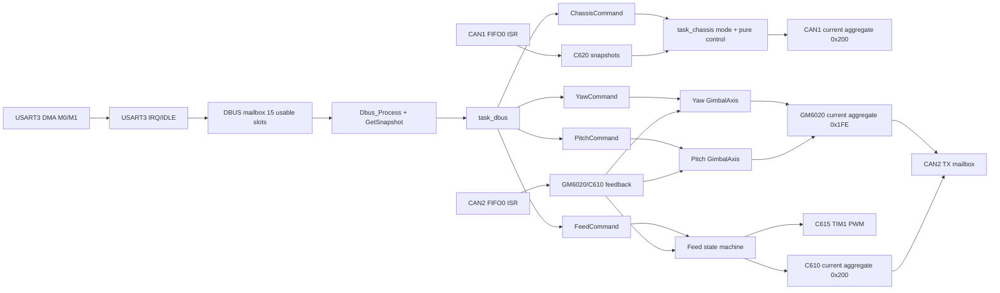

# yuntai 技术架构与算法说明

## 输入诊断采集

USART1设为921600/8N1，`LOG_DBUS_TRACE_ENABLE=1`独占分类；控制仍走原任务和四个命令邮箱。DBUS DMA ISR除原HAL ms外保存DWT周期，不清零共用计数；`Dbus_ProcessObserved()`在任务提交每个合法帧后调用只读观察者，原始帧逐份进入任务私有环。任务发布完同周期命令后记录实际输出、累计位移和X/Y阶段，变化逐2 ms周期观察；不变时100 ms心跳。接收时间、算法时间、命令记录时间分别保留，CSV通过帧序号关联，误把打印时间当接收时间会歪曲保持/回中时序。

`task_dbus_trace.c`包含128条×60字节记录和704字节文本暂存，忙时不等待，仅在唯一日志后端接受完整批次后出队；满时丢新诊断记录并计数，不能改变真实输入消费或控制许可。DBUS接收邮箱溢出与诊断日志丢样分开报告。完整字段、回绕处理、验证范围与带宽限制见[DBUS采集说明](modules/dbus/README.md#摇杆与鼠标输入采集)。`.ioc`保存波特率，USART1用户区应用相同参数，不改生成区；固件由用户在VS Code构建和烧录。

> **文档状态**：与源码同步的设计说明，2026-10-18。当前正式云台采用六轴IMU双轴自稳，磁工作暂停；参数以 `Core/Inc/**/**_config.h` 和 BSP 头文件为准，实际调度与机械量保留“待实测”标记。
>
> **适用范围**：STM32F407、HAL、FreeRTOS、CAN 电机、DJI DBUS、TIM1 PWM 和 USART1 DMA 日志组成的当前 `yuntai` 工程。

这份文档回答三个问题：系统由哪些层组成、每个控制周期如何把输入变成硬件输出、配置宏改变的是哪条公式或哪条安全路径。模块级接口仍以 `doc/modules/**/README.md` 和头文件注释为准；本文件负责串起跨模块的数据流。

## 1. 设计基线与代码地图

工程的调用方向是：任务组合应用和驱动，应用组合纯算法与驱动；纯算法不依赖 HAL、CAN 或 FreeRTOS。启动层只负责把这些组件按硬件生命周期连接起来：

```text
任务适配（DBUS/Yaw/Pitch/Feed/Chassis 命令、参数和周期）
      ↓ 调用
应用控制（GM6020 单轴、级联控制、四轮混控） ─┐
      ↓ 调用                           │
纯算法（PID、Ramp、低通、角度补偿、鼠标虚拟摇杆）
      ↑                                 │
BSP 驱动（CAN、DBUS、TIM1、日志） ◄────┘
      ↑
CubeMX/HAL 外设
```

其中“纯算法”同时被任务适配层直接调用（例如 DBUS 的鼠标虚拟摇杆），上图箭头表示运行时调用，而不是要求所有 C 头文件形成单向包含图。

主要目录与职责：

| 层 | 目录 | 作用 | 不负责的内容 |
|---|---|---|---|
| 生成入口 | `Core/Src/main.c`、`freertos.c`、`*.ioc` | 初始化外设、创建任务、启动调度器 | 业务控制算法 |
| CAN BSP | `Core/Src/bsp/can`、`c610_m2006`、`gm6020`、`m3508_c620` | 收发协议、反馈解码、注册表、在线门 | 位置环和机械判定 |
| 输入 BSP | `Core/Src/bsp/dbus` | USART3 DMA 双缓冲、DBUS 帧校验和快照 | 轴目标计算 |
| PWM BSP | `Core/Src/bsp/snail_2305` | TIM1 CH1/CH2、C615 脉宽范围和 Ramp | C615 实际转速闭环 |
| 纯算法 | `Core/Src/algorithm` | 只读数值输入，返回数值输出 | HAL、CAN、FreeRTOS |
| 云台应用 | `Core/Src/app/gimbal` | GM6020 连续角度、位置/速度环、限位和补偿组合 | 任务创建、DBUS 解析 |
| 底盘应用 | `Core/Src/app/chassis` | 四轮混控、键盘曲线、四个独立 PID | HAL、DBUS、任务配置与 CAN |
| 任务 | `Core/Src/task` | 读取命令、取得快照、调用控制器和发送周期输出 | 在 ISR 中做耗时工作 |
| 日志 | `Core/Src/app/log` | USART1 DMA 单缓冲非阻塞发送 | 控制安全和任务调度 |

完整源文件由顶层 `CMakeLists.txt` 显式加入。新增业务 `.c` 必须同时加入该文件；CubeMX 管理文件的用户修改只放在 `USER CODE` 区域。

## 2. 启动、任务与调用关系

### 2.1 启动顺序

`main()` 执行以下顺序：

1. `HAL_Init()` 和时钟配置。
2. 初始化 GPIO、DMA、CAN1、USART1、USART3、TIM1、CAN2。
3. 配置 CAN1 bank0 的 `0x201~0x204` 列表与 CAN2 bank14 的全零掩码，分界值均为 14；启动双 CAN 并打开各自 FIFO0 pending 通知。
4. `osKernelInitialize()`，由 `MX_FREERTOS_Init()` 创建 DBUS、Yaw、Pitch、供弹和底盘五个任务。用户已通过 CubeMX 新增唯一 `task_chassis`，独立强入口接入 CMake 并覆盖生成弱入口。
5. `osKernelStart()` 后，业务在任务和 CAN 中断中运行。

正式供弹和 C615 独立 PWM 测试启动时分别初始化所需的驱动；C610 角度步长测试只注册 CAN2 ID1 的 C610/M2006，不启动 C615。任一所需驱动初始化失败，任务保持停止输出并按 `FEED_MOTOR_INIT_RETRY_MS` 重试；不能把“句柄注册成功”当成“电机已经在线”。

### 2.2 周期任务表

| 任务 | 默认周期 | 输入 | 输出 | 时间基准 |
|---|---:|---|---|---|
| `task_dbus` | 2 ms | USART3 DMA 快照 | Yaw、Pitch、Feed、Chassis 命令邮箱 | HAL ms + FreeRTOS Tick 调度 |
| `task_feed_motor` | 2 ms | DBUS 左键、C610 反馈 | C615 PWM、M2006 CAN 电流 | HAL ms 检查新鲜度；Tick 计阶段 |
| `task_yaw` | 2 ms | Yaw 命令、GM6020 反馈 | GM6020 ID1 电流 | HAL ms + 固定配置 `dt_ms=2` |
| `task_pitch` | 2 ms | Pitch 命令、GM6020 反馈 | GM6020 ID2 电流 | HAL ms + 固定配置 `dt_ms=2` |
| `task_chassis` | 2 ms | CH2/CH3、键盘、四轮快照 | CAN1 C620 聚合 `0x200` | HAL ms 实际 dt；Tick 调度 |
| CAN FIFO0 ISR | 事件触发 | CAN 反馈帧 | 驱动反馈结构 | `HAL_GetTick()` 时间戳 |
| USART1 DMA 完成回调 | 事件触发 | DMA 状态 | 释放日志缓冲区 | ISR，仅做所有权释放 |

`vTaskDelayUntil()` 保持绝对唤醒点。供弹正式运行时通过前后 Tick 差计算实际 `dt_ms`；Yaw/Pitch 的任务入口直接向控制器传入配置周期 2 ms，当前没有测量迟到周期。这两种实现必须区分：云台发生调度超期时，目标积分、积分项和电流 Ramp 仍按 2 ms 计算，需要台架测量执行时间和调度抖动。

底盘从前后 `HAL_GetTick()` 差计算实际 `dt_s`；首周期、dt=0 或超过 100 ms 清历史并发零。入口迟到时重设唤醒锚点，不连续补发过期周期。初始化失败每 100 ms 重试，不阻塞其它任务。

### 2.3 一次完整数据流

```text
DBUS DMA
  → HAL/USART 回调只记录帧
  → Dbus_Process() 解码并校验
  → Dbus_GetSnapshot()
  → task_dbus 每 2 ms 从同一输入快照发布四份命令
       ├─ YawCommand_Submit()
       ├─ PitchCommand_Submit()
       ├─ FeedMotorCommand_Submit()
       └─ ChassisCommand_Submit()（CH2/CH3、键盘、真实接收时刻）

CAN FIFO0 中断
  → can_rx_dispatch.c 取出一帧
  → CAN1: C620_M3508_HandleRxMessage()
  → CAN2: Gm6020_HandleRxMessage()/C610_M2006_HandleRxMessage()
  → 更新时间戳、反馈字段和连续角度

供弹任务
  → 命令年龄门 + C610 反馈年龄门
  → C615 脉宽 Ramp
  → 供弹步长状态机 + M2006 固定电流
  → C610_M2006_SetCurrent()/SetOutputEnabled()
  → C610_M2006_SendAll() → CAN 0x200

底盘唯一任务（已由 CubeMX 创建，实际调度待上板）
  → Ctrl 模式事件 + 命令年龄门 + 各轮反馈门
  → ChassisControl_Update() 三轴曲线/四轮混控/PID
  → 安装方向变换 → C620_M3508_SendAll() → CAN1 0x200
```

任务只消费值副本。CAN ISR 不打印、不等待、不调用普通 FreeRTOS API；日志也不参与控制决策。

## 3. 两种时间和并发规则

工程有两个不能混用的时基：

| 时基 | 来源 | 用途 |
|---|---|---|
| HAL ms | `HAL_GetTick()` | DBUS 命令年龄、CAN 反馈年龄、反馈时间戳 |
| FreeRTOS Tick | `xTaskGetTickCount()` | `vTaskDelayUntil()`、供弹阶段计时、日志限频 |

毫秒配置在与 Tick 比较时必须写成 `pdMS_TO_TICKS(value_ms)`。即使当前 `configTICK_RATE_HZ=1000`，也不能依赖两者数值恰好相等。

时间差用无符号减法支持计数器回绕：

```c
uint32_t age = now - stamp;
if (age <= INT32_MAX && age >= timeout_ms) {
  /* 过期 */
}
```

如果 ISR 在取得 `now` 后写入了略新的时间戳，减法可能看起来像巨大下溢；代码将大于半个 `uint32_t` 周期的差值解释为 0 ms。时间戳为 0 ms 仍可能是有效首帧，必须使用 `feedback_received` 或 `g_received` 额外区分“未收到过”。

共享数据的规则：

- DBUS 命令邮箱：任务临界区复制 `enabled`、按钮和时间戳的完整结构。
- C610/GM6020 反馈：ISR 用奇偶 `feedback_sequence` 包住多字段更新，任务通过 `GetFeedback()`/`GetSnapshot()` 重试取得同一帧。
- C610 聚合发送：读取所有电机槽位、构建 8 字节帧、提交 HAL 邮箱处于同一短临界区；临界区内不等待、不打印。
- C620：注册、快照、许可/电流和完整聚合提交使用保存/恢复 PRIMASK 的短临界区；不会读取 ISR 更新一半的字段。底盘模式及 PID 仅由底盘任务持有，DBUS 只写命令值副本和 Ctrl 事件计数。
- 日志 DMA：原子取得唯一缓冲区所有权，DMA 完成回调释放；忙或超长文本直接拒绝，下一周期重试。

## 4. CAN 协议与角度展开

### 4.1 C610/M2006

C610/M2006 使用标准 CAN、DLC=8：

| 帧 | ID | 内容 |
|---|---:|---|
| 控制低组 | `0x200` | ID1~4，每台占两个字节 |
| 控制高组 | `0x1FF` | ID5~8，每台占两个字节 |
| 反馈 | `0x200 + motor_id` | ID1 对应 `0x201` |

反馈字段均为大端：角度 `DATA[0:1]`、速度 `DATA[2:3]`、实际电流 `DATA[4:5]`。`DATA[6]` 按 C610 手册保留，`DATA[7]` 为错误码；保留字段不参与保护判断。

编码器一圈为 8192 count。ISR 每收到一帧执行：

```c
delta = angle_raw - previous_angle_raw;
if (delta > 4096)  delta -= 8192;
if (delta < -4096) delta += 8192;
angle_total_raw += delta;
```

这是假设相邻帧角位移小于半圈的最小回绕展开算法。它把 `8190 → 2` 解释为 `+4`，而不是 `-8188`。如果反馈丢帧导致实际位移超过半圈，方向不能唯一判断；这属于待实测的通信/速度边界。

C610 电流协议范围是 `[-10000, 10000]`，不能套用 GM6020/C620 的 `[-16384, 16384]`。`C610_M2006_SetCurrent()` 先钳位目标缓存；`SendAll()` 在反馈过期或输出未使能时强制槽位为零。

### 4.2 GM6020

GM6020 也使用 CAN 聚合帧，但电流协议范围是 `[-16384, 16384]`。Yaw 使用 GM6020 电调 ID1（反馈 `0x205`），Pitch 使用 ID2（反馈 `0x206`）。GM6020 反馈 ID 是 `0x204+电调编号`，与 C610 的 `0x200+编号` 不同。当前两轴电流聚合到 `0x1FE`，分别占 DATA[0:1] 和 DATA[2:3]；每轴拥有独立句柄和控制历史。

GM6020 反馈 DATA[6] 是温度，DATA[7] 是保留字节；C610 对这两个字节的定义不同。`GimbalAxis` 统一经过反馈新鲜度、标定和参数有效性检查，驱动发送前还检查新鲜度。协议温度被记录，并没有温度阈值保护。

## 5. 纯算法模块

### 5.1 PID：离散计算与抗积分饱和

`algorithm/pid/pid.c` 的输入误差单位由调用者定义，周期为秒：

\[
I_k=\operatorname{clamp}(I_{k-1}+K_i e_k\Delta t, I_{min}, I_{max})
\]
\[
u^*=K_p e_k+I_k+K_d\frac{e_k-e_{k-1}}{\Delta t}
\]
\[
u_k=\operatorname{clamp}(u^*,u_{min},u_{max})
\]

首帧把 `previous_error` 设为当前误差，避免默认上一误差为 0 导致微分尖峰。输出饱和时，只有能把输出拉回饱和区的积分方向才被保存，这就是抗积分饱和。

供弹 M2006 当前不使用 PID。每个步长直接发送配置的固定供弹电流：

\[
I_{feed}=FEED\_MOTOR\_FEED\_CURRENT\_RAW\times FEED\_MOTOR\_CURRENT\_SIGN
\]

步长是否结束由连续角度目标比较判定。电流仍受
`FEED_MOTOR_MAX_CURRENT_RAW` 和 C610 协议范围限制。

Yaw/Pitch 的速度内环使用完整 PID；位置外环的积分候选在目标速度饱和且误差仍向饱和方向时回退上一周期积分，避免“大误差一次积分后反向越限”。

### 5.2 Ramp：按速率限幅

`algorithm/ramp/ramp.c` 的目标、历史值和速率必须使用同一单位：

\[
\Delta_{max}=r\Delta t_s
\]
\[
x_k=x_{k-1}+\operatorname{clamp}(x^*-x_{k-1},-\Delta_{max},+\Delta_{max})
\]

C615 当前由 `1000~1400 us` 在 `10 ms` 内启动，速率为：

\[
r_{PWM}=\frac{1400-1000}{0.010}=40000\;us/s
\]

Shift 释放或故障均调用 `Snail2305_Stop()` 重建 Ramp 起点并立即写停止值，不等待减速 Ramp。CCR 预装载最迟下一 20 ms 周期生效，实际轮子停止仍受惯性影响。

### 5.3 一阶低通

速度滤波使用：

\[
y_k=y_{k-1}+\alpha(x_k-y_{k-1})
\]

`alpha` 越小，噪声越小但相位滞后越大。低通只能减小测速噪声，不能替代反馈年龄检查；反馈掉线时必须先走安全门。

### 5.4 鼠标虚拟摇杆

DBUS 鼠标字段是相对位移，不是绝对位置。算法为 X/Y 各保存独立状态：

1. 通过帧序号去重，重复快照不重复消费位移。
2. 新位移按接收间隔测速：`v=clamp(delta_count * gain_permille_per_count * reference_period_ms / dt_ms, ±limit)`，替换旧速度；零位移新帧清本轴，不累计速度。
3. `dt_ms` 为本批与上批末帧的接收时间差；任务延迟时分子为该批位移代数和，分母覆盖对应间隔。首帧及同毫秒帧用参考周期作分母，避免除零。
4. 无新帧时，从最后非零接收时间保持 `hold_ms`，再在 `decay_ms` 内按绝对时间线性回中：
   
\[
v(t)=v_0\frac{T_{decay}-(t-T_{hold})}{T_{decay}}
\]

5. 离线、时间倒退、帧序号回退、NaN/Inf 或输出指针非法时清零全部状态。

当前 DBUS 鼠标参数来自 `task_dbus_config.h`：Yaw/Pitch参考周期增益均`5.0‰/count`，`reference_period_ms=14 ms`；缺帧保持14 ms、回中14 ms，鼠标分量上限300‰。用户选择按移动快慢决定转速、停手快速停止和反向立即响应；实际C回放及完整性证据见[输入分析](modules/mouse_virtual_joystick/input_trace_analysis_20261019.md)。两轴满输入40 rpm时鼠标单独目标移动上限12 rpm（72°/s）；摇杆及闭环纠偏不受此上限约束。这些值是手感参数，不是电机协议量。

## 6. 云台控制算法

### 6.1 命令到目标角度

2026-10-19用户确认方向正常。Pitch物理下挡块8184～8187高于原人工下界8136，改8250留约2.8～2.9°；Pitch边界仍只约束人工新增目标/前馈。正式Yaw采用下节边界让步策略。最新鼠标及控制调参以配置头和宏附录为准；实际Pitch抖动、余量及Yaw反转效果仍待用户上板验收，历史记录见[Pitch复测](modules/gimbal/pitch_stop_mouse_speed_20261019.md)。

正式两轴使用惯性参考：Yaw为连续累计航向，Pitch为当前俯仰，进入时捕获当时姿态一次。`GimbalControl_FeedbackTypeDef`将控制角/速度与机械编码器分开；角度乘8192/360成为等效count，机体系陀螺q/r先按ZYX关系投影：`Pitchdot=q*cos(Roll)-r*sin(Roll)`、`Yawdot=(q*sin(Roll)+r*cos(Roll))/cos(Pitch)`，再乘60/(2π)成为rpm。角度和欧拉角速度同乘对应`feedback_sign`：当前Yaw=-1（2026-10-19编码器/惯性双向反号实测），Pitch=+1（用户确认正常），既有增益数值不变。

Yaw/Pitch 接收的是 `[-1000,1000]‰` 的相对速度命令。命令速度换算为 rpm：

\[
v_{cmd}=\frac{p}{1000}V_{max}
\]

再按编码器一圈 8192 count 积分目标：

\[
q^*_k=q^*_{k-1}+v_{cmd}\frac{8192}{60}\Delta t_s
\]

行程内零输入、命令失效或超时冻结最后目标。正式 Yaw 到达边界后允许向外不可达目标让步。反馈恢复时清 PID、滤波和 Ramp 历史，先保留目标，再于输出前应用本轴边界策略。

### 6.2 软件限位

Pitch 机械范围只限制人工命令，保留原保持、PID纠偏和重力补偿。正式 Yaw 默认 `YAW_BOUNDARY_YIELD_ENABLE=1`，机械编码器达到/越过下界且控制目标误差为负，或达到/越过上界且误差为正时，先将目标更新为当前控制角，再处理人工增量。范围外启动不自动拉回；IMU 连续航向不钳位，不直接将惯性角与机械 min/max 比较，也不将误差折返到 ±180°。

在最小边界且命令继续减小，或在最大边界且命令继续增大时，代码同时屏蔽：

- 目标角度积分；
- 速度前馈。

反向命令同周期生效。在机械范围内，仅对非零人工输入用`机械角+保存目标-控制角`估计目标对应的机械角，缩小本次新增目标增量；被拒绝部分同时从前馈去除。实际反馈到达/越过边界时向内增量完整接受。正式 Yaw 在两级积分更新前后清向外积分，保留向内积分；边界状态变化时用真实速度初始化滤波并重建速度 PID 微分参考。固定机械角测试独立关闭让步，配置目标越界则整周期发零。

### 6.3 级联位置/速度环

位置外环输出目标速度：

\[
v^* = K_{p,pos}e + I_{pos}+K_{d,pos}\dot e + K_{ff}v_{cmd}
\]

其中：

\[
e=q^*-q
\]

目标速度先限幅到 `±MAX_SPEED_TARGET_RPM`，速度误差为：

\[
e_v=v^*-v_{filtered}
\]

速度内环 PID 输出 GM6020 电流：

\[
i_{loop}=PID(e_v,\Delta t_s)
\]

Pitch 还叠加重力补偿：

\[
i_g=s_g(B+A\cos(2\pi(q-q_c)/8192))
\]

重力公式中的`q`始终为机械编码器角，外环误差中的`q`为当前控制参考系角。重力角差使用 `int64_t` 求差后再取 8192 周期，避免大连续角度转成 float 后丢失小角差。最终电流：

\[
i=\operatorname{Ramp}\left(\operatorname{clamp}(i_{loop}+i_g,-I_{max},I_{max})\right)
\]

Yaw 默认关闭重力补偿；Pitch 当前默认偏置 4500 raw、幅值 1500 raw、补偿开启。补偿方向 `*_GRAVITY_CURRENT_SIGN` 与闭环电流方向独立。

上述 Ramp 结果在正式 Yaw 还需经过机械边界电流方向门：下界拒绝负逻辑电流，上界拒绝正逻辑电流，再转换电机电流符号。被拒绝时输出及 Ramp 历史同步置零，避免反转时抵消旧向外斜坡。向内电流保留；方向限制不关闭输出许可。Pitch 和固定机械角测试不执行此门。

### 6.4 当前 Yaw/Pitch 关键宏

| 参数组 | 宏 | 当前值 | 作用 |
|---|---|---:|---|
| 模式 | `*_HARDWARE_TEST_MODE` | 0 | 0 正式、1 只读标定、2 固定角度闭环 |
| 惯性模式 | `*_STABILIZATION_ENABLE`、`*_IMU_FEEDBACK_SIGN` | 开启1；Yaw=-1/Pitch=+1 | 六轴反馈及到编码器方向映射；固定机械角测试不使用INS |
| Yaw 边界策略 | `YAW_BOUNDARY_YIELD_ENABLE` | 1 | 无量纲0/1；1让步不可达向外目标、清向外积分并限制Ramp后向外电流，0只限制人工命令；固定目标始终关闭 |
| 惯性资格 | `*_IMU_READY_MS`、`*_IMU_TIMEOUT_MS` | 100/10 ms | 持续有效更新窗口及陀螺/加计新鲜度 |
| 奇异区迟滞 | `*_IMU_EXIT_PITCH_DEG`、`*_IMU_ENTER_PITCH_DEG` | 80/75° | 退出到编码器保持、回到内区重新资格确认 |
| 标定 | `*_CALIBRATION_VALID` | 1 | 未完成标定时正式输出保持为零 |
| 周期/超时 | `*_TASK_PERIOD_MS`、`*_COMMAND_TIMEOUT_MS`、`*_FEEDBACK_TIMEOUT_MS` | 2/100/100 | 调度、命令有效期、反馈安全门 |
| 输入速度 | `*_MAX_COMMAND_SPEED_RPM` | 40 | 满输入速度 |
| 目标速度 | `*_MAX_SPEED_TARGET_RPM` | Yaw 95 / Pitch 70 | 位置外环输出限幅 |
| 位置环 | `*_POSITION_KP/KI/KD_*` | 轴独立 | count→rpm 的外环增益、积分、阻尼 |
| 速度环 | `*_SPEED_KP/KI/KD_*` | 轴独立 | rpm→GM6020 raw 的内环增益 |
| 电流 | `*_MAX_CURRENT_RAW` | 7000 | GM6020 总输出限幅，协议上限 16384 |
| Ramp | `*_CURRENT_SLEW_RAW_PER_S` | 60000 | 电流最大变化率 |
| 滤波 | `*_SPEED_FILTER_ALPHA` | Yaw 0.20 / Pitch 0.15 | 速度低通权重 |
| 重力 | `PITCH_GRAVITY_*` | 开启、4500、1500 | Pitch 余弦补偿；Yaw 默认关闭 |

完整的轴独立宏和单位注释放在 `task_yaw_config.h`、`task_pitch_config.h`，不要在 BSP 中复制这些产品参数。

轴配置中的每个产品宏都落在下面四类之一：模式/标定决定是否允许闭环，输入/时序决定目标如何变化，级联增益决定误差如何变成速度和电流，补偿/日志决定附加电流和观测开销。

| 宏模式 | Yaw 当前值 | Pitch 当前值 | 直接进入的算法 |
|---|---:|---:|---|
| `*_HARDWARE_TEST_MODE_OFF/CALIBRATION/ANGLE_LOOP` | 0/1/2 | 0/1/2 | 编译期选择正式、只读标定或固定目标测试路径 |
| `*_HARDWARE_TEST_MODE` | OFF | OFF | 任务入口分支；测试路径与正式路径互斥 |
| `*_CALIBRATION_VALID` | 1 | 1 | `GimbalAxis_Init()` 的标定安全门；无效时发零 |
| `*_TASK_PERIOD_MS` | 2 | 2 | `vTaskDelayUntil()` 周期；Yaw/Pitch 控制器固定使用 2 ms，供弹正式路径另测实际 Tick 差 |
| `*_FEEDBACK_TIMEOUT_MS` | 100 | 100 | `HAL_GetTick()` 反馈年龄门；过期发零 |
| `*_COMMAND_TIMEOUT_MS` | 100 | 100 | 命令快照年龄；失效后以零速度保持目标 |
| `*_TASK_LOG_PERIOD_MS` | 500 | 500 | 正式任务日志成功发送后的限频 |
| `*_CALIBRATION_CENTER_ANGLE_RAW` | 2100 | 8753 | 重力补偿中心、固定目标相对中心和标定参考 |
| `*_CALIBRATION_MIN_ANGLE_RAW` | 115 | 8250 | 人工软件下界；Pitch实测挡块8184～8187，留63～66 count余量，向外负命令被过滤 |
| `*_CALIBRATION_MAX_ANGLE_RAW` | 4085 | 9350 | 软件最大边界；向外正命令被过滤 |
| `*_MOTOR_CURRENT_SIGN` | 1 | 1 | 控制器逻辑电流到物理 CAN 电流的符号 |
| `*_FEEDBACK_SPEED_SIGN` | 1 | 1 | 原始 rpm 到逻辑速度的符号 |
| `*_GRAVITY_COMPENSATION_ENABLE` | 0 | 1 | 是否计算余弦补偿；Yaw 关闭，Pitch 开启 |
| `*_GRAVITY_COMPENSATION_BIAS_CURRENT_RAW` | 0 | 4500 | 补偿模型的常值项 `B` |
| `*_GRAVITY_COMPENSATION_AMPLITUDE_CURRENT_RAW` | 0 | 1500 | 补偿模型的余弦幅值 `A` |
| `*_GRAVITY_CURRENT_SIGN` | 1 | 1 | 补偿电流独立于闭环电流的符号 |
| `*_MAX_COMMAND_SPEED_RPM` | 40 | 40 | `permille/1000 × Vmax` 的输入速度换算 |
| `*_VELOCITY_FEEDFORWARD_GAIN` | 1.2 | 0.8 | 位置环输出中的 `Kff × command_speed` |
| `*_MAX_SPEED_TARGET_RPM` | 95 | 70 | 位置外环目标速度限幅 |
| `*_POSITION_KP_RPM_PER_RAW` | 0.01 | 0.05 | 角度误差到目标 rpm 的比例项 |
| `*_POSITION_KI_RPM_PER_RAW_S` | 0 | 2 | 位置积分项，按 `error × dt_s` 累加 |
| `*_POSITION_INTEGRAL_LIMIT_RPM` | 5 | 5 | 位置积分限幅和目标速度饱和回退边界 |
| `*_POSITION_KD_RPM_S_PER_RAW` | 0 | 0 | `command_speed-filtered_speed` 形成的误差变化阻尼 |
| `*_SPEED_KP_CURRENT_PER_RPM` | 200 | 200 | 速度误差到 raw 电流的比例项 |
| `*_SPEED_KI_CURRENT_PER_RPM_S` | 20 | 20 | 速度 PID 积分项 |
| `*_SPEED_KD_CURRENT_S_PER_RPM` | 1.5 | 0 | 速度误差微分项；测速噪声大时会放大尖峰 |
| `*_SPEED_INTEGRAL_LIMIT_RAW` | 7000 | 7000 | 速度 PID 积分历史限幅 |
| `*_MAX_CURRENT_RAW` | 7000 | 7000 | 闭环与补偿合成后的轴电流限幅 |
| `*_CURRENT_SLEW_RAW_PER_S` | 60000 | 60000 | 合成电流进入 CAN 前的 Ramp 速率 |
| `*_SPEED_FILTER_ALPHA` | 0.20 | 0.15 | 一阶低通 `y += alpha × (x-y)` |
| `*_ANGLE_LOOP_TARGET_ANGLE_DEG` | 30 | 0 | 固定目标测试中相对中心的角度；换算为 count 后检查边界 |
| `*_ANGLE_LOOP_LOG_PERIOD_MS` | 200 | 200 | 固定目标测试日志限频 |
| `*_CALIBRATION_LOG_PERIOD_MS` | 200 | 200 | 只读标定角度日志限频 |
| `*_CALIBRATION_PROMPT_PERIOD_MS` | 3000 | 5000 | 标定操作提示限频，不参与电流控制 |

表中 `*` 代表 `YAW` 或 `PITCH`。例如把 `PITCH_POSITION_KP_RPM_PER_RAW` 从 0.05 调到 0.08，只改变“角度误差→目标速度”的比例项；它不会改变速度内环的 `PITCH_SPEED_KP_CURRENT_PER_RPM`，也不会改变最大电流。调整级联环时应先根据各级限幅计算饱和误差，再逐组修改。

### 6.5 反馈切换、恢复和诊断

每轴所属任务独占运行时/控制器，以2 ms周期各取一次CAN与INS快照，控制和日志共用。本周期CAN角用于人工限位、可选边界让步及既有重力模型；INS姿态/陀螺用于惯性闭环。时龄/资格窗口使用HAL毫秒，任务调度用转换后的FreeRTOS Tick。

IMU未就绪、姿态无效、陀螺/加计任一年龄超过10 ms、INS重置或绝对Pitch≥80°时，捕获一次真实编码器角保持并暂停人工运动；目标允许在机械范围外。有效新样本持续更新100 ms后重新捕获惯性姿态，Pitch须回到≤75°。参考切换清积分并用真实速度初始化滤波，延续当前电流Ramp，切换周期不积分输入。CAN失效立即发零；恢复首周期清动态历史及Ramp，INS参考连续则保留最后目标；期间发生IMU故障则恢复后先捕获编码器再重新确认资格。无标定许可、非法参数/数值仍零电流。机械标定与固定目标测试绕过INS。

日志分别给出反馈来源、人工受限、目标让步、向外电流受限、输入暂停、机械边界、计算电流、输出许可及CAN提交；方向门置零不等于故障禁用。当前真实控制器、运行时、任务配置及驱动临时主机检查18219项/3015次CAN提交通过，包含日志开启与Pitch/固定测试回归。仅交付源码，不生成固件；用户上板验收及近水平底盘假设见 [Yaw边界让步](modules/gimbal/yaw_boundary_yield.md)。实际精度、六轴Yaw漂移、倾斜适用性及带载增益待测。

## 7. 供弹系统：机械、状态机和公式

### 7.1 硬件组合

- C615 CH1：PE9/TIM1_CH1。
- C615 CH2：PE11/TIM1_CH2。
- TIM1：1 MHz 计数、20000 us 周期，即 50 Hz。
- M2006：CAN2、C610 ID1、反馈 `0x201`、控制 `0x200`。

C615 是开环 PWM：停止值、活动值和 Ramp 由供弹配置提供；代码只知道最近写入的 CCR，不知道真实转速。M2006 使用连续角度固定步长和固定电流；目标方向比较之外还检查本步实际位移，防止反馈方向配置错误导致无限输出。

### 7.2 命令和安全门

```text
command_enabled = DBUS有效
                && 命令未超过100 ms
                && C610 已收到新鲜反馈（<100 ms）
                && 供弹驱动初始化成功
```

鼠标左键和键盘 Shift 是两个独立命令：左键只进入 C610 步长状态机，Shift 只决定 C615 PWM 目标。
命令超时或反馈失效当周期清零 C610，并直接写 C615 停止脉宽。

### 7.3 步长状态机

| 状态 | 进入条件 | 输出 | 离开条件 |
|---|---|---|---|
| `STOP` | 没有未完成步长 | M2006=0；C615 由 Shift 独立控制 | 左键按下沿且安全门有效 |
| `STEP` | 左键按下沿，或上一步停顿结束且仍长按 | M2006 固定步长电流；C615 由 Shift 独立控制 | 达到当前连续角度目标 |
| `WAIT_NEXT_STEP` | 每步完成且仍按住；从到位时刻开始计停顿 | M2006=0；C615 由 Shift 独立控制 | 松键进入 STOP；长按阈值与停顿都满足才建立下一步 |

```text
左键按下沿 → STEP(target = angle_count + FEED_MOTOR_STEP_COUNTS)
STEP → 目标达到且左键释放 → STOP
STEP → 目标达到且左键仍按住 → WAIT_NEXT_STEP(记录到位Tick，立即零电流)
WAIT_NEXT_STEP → 长按已满400 ms、到位后已满200 ms且仍按住 → STEP(以当前位置建立下一步)
WAIT_NEXT_STEP → 左键释放 → STOP
Shift 按住 → C615 活动 PWM；Shift 松开 → C615 停止 PWM
```

短按只完成一个步长。释放发生在步长中间时，C610 继续到目标后停止；释放不会反向或取消目标。
长按在按下沿的 FreeRTOS Tick 起计满 400 ms，且本步到位后零电流停顿满 200 ms，才建立下一目标。
两项计时使用独立起点、同源无符号 Tick 差和 `pdMS_TO_TICKS()`；停顿不能从按下沿计时，
也不能在长按阈值达到后省略。停顿中松键取消重复；200 ms 由用户本轮确认。
步长正负由 `FEED_MOTOR_STEP_COUNTS` 符号决定，比较分别使用 `>=` 或 `<=`。

### 7.4 步长计算和 PWM

连续反馈由 C610 驱动根据 8192 count/rev 展开，避免单圈 0/8191 回绕影响比较：

```c
target_count = angle_count + FEED_MOTOR_STEP_COUNTS;
if (FEED_MOTOR_STEP_COUNTS > 0) {
    reached = angle_count >= target_count;
} else {
    reached = angle_count <= target_count;
}
reached = reached || abs(angle_count - start_count) >=
                   abs(target_count - start_count);
```

目标建立前检查 `int64_t` 加法边界，溢出会清零并进入 STOP。每次目标到位的周期都返回零电流，
按住则保存 `step_finished_tick` 并进入 WAIT_NEXT_STEP。每周期等待长按和停顿条件，不阻塞任务；
停顿结束后用最新反馈建立下一目标，不沿用惯性移动前的位置。电流公式为
`sign(FEED_MOTOR_STEP_COUNTS) × FEED_MOTOR_FEED_CURRENT_RAW × FEED_MOTOR_CURRENT_SIGN`；
当前 +4000 count、+1 电流符号对应 +5000 raw。+4000 count 是电机转子约 +175.78°，拨弹盘角度还需按实际减速比换算。

C610 不使用停滞窗口、预旋或单发保持；正在执行目标时不排队额外短按，目标处发零不提供主动位置制动，
惯性超调待实测。C615 Shift 按下经 Ramp 启动，松开同周期直接写停止脉宽。位移条件只防止反向反馈导致
目标不可达；长按仍会重复，不能代替方向确认。PWM CCR 不代表实际轮速。

### 7.5 供弹宏逐项说明

| 宏 | 当前值 | 改变的算法或行为 |
|---|---:|---|
| `FEED_MOTOR_TASK_PERIOD_MS` | 2 ms | 任务周期和反馈采样周期 |
| `FEED_MOTOR_INIT_RETRY_MS` | 100 ms | 初始化失败重试节流 |
| `FEED_MOTOR_COMMAND_TIMEOUT_MS` | 100 ms | 命令年龄安全门 |
| `FEED_MOTOR_ID` | 1 | 反馈 `0x201` 和控制帧槽位 |
| `FEED_MOTOR_STEP_COUNTS` | +4000 count | 非零；沿用当前单发增量；符号同时决定目标和逻辑电流方向 |
| `FEED_MOTOR_CONTINUOUS_PRESS_MS` | 400 ms | 长按连续步长阈值；短按完成一步后等待松键 |
| `FEED_MOTOR_STEP_PAUSE_MS` | 200 ms | 用户确认；范围 (0,INT32_MAX] 且至少 1 Tick；每步到位后的零电流等待，增大降低重复频率 |
| `FEED_MOTOR_FEED_CURRENT_RAW` | 5000 raw | STEP 阶段 C610 固定电流幅值，沿用本轮起始配置 |
| `FEED_MOTOR_MAX_CURRENT_RAW` | 5000 raw | C610 供弹电流上限，沿用本轮起始配置 |
| `FEED_MOTOR_FEEDBACK_SIGN` | +1 | 原始角度/速度到逻辑方向的符号 |
| `FEED_MOTOR_CURRENT_SIGN` | +1 | 取 ±1；最终电流为步长符号 × 本符号 × 电流幅值 |
| `FEED_MOTOR_SNAIL_STOP_PULSE_US` | 1000 us | Shift 松开和故障停止值 |
| `FEED_MOTOR_SNAIL_ACTIVE_PULSE_US` | 1400 us | 范围 (STOP,MAX]；Shift 按住时的 C615 目标，沿用当前源码值 |
| `FEED_MOTOR_SNAIL_MAX_PULSE_US` | 1550 us | PWM 运行上限 |
| `FEED_MOTOR_SNAIL_RAMP_TIME_MS` | 10 ms | 正数；仅启动脉宽变化时间，松键停止绕过 Ramp |
| `FEED_MOTOR_ANGLE_STEP_TEST_ENABLE` | 0 | C610 只读手动反馈测试开关 |
| `FEED_MOTOR_ANGLE_STEP_TEST_FEEDBACK_SIGN` | -1 | 手动测试反馈符号 |
| `FEED_MOTOR_ANGLE_STEP_TEST_LOG_PERIOD_MS` | 100 ms | 手动测试日志周期 |

正式路径与两个独立硬件测试分支互斥。C610 自循环和 C615 行程/转向校准测试已删除。
角度测试只读反馈并始终提交零电流；完成后必须恢复 `FEED_MOTOR_ANGLE_STEP_TEST_ENABLE=0`。
## 8. DBUS、日志和配置宏

### 8.1 DBUS 宏

`task_dbus_config.h` 的关键宏：

| 宏 | 当前值 | 算法意义 |
|---|---:|---|
| `DBUS_TASK_PERIOD_MS` | 2 | 解码、虚拟鼠标和命令发布周期 |
| `DBUS_TASK_LOG_PERIOD_MS` | 100 | DBUS 遥测节流 |
| `DBUS_STICK_DEADBAND_RAW` | 10 | 摇杆小幅回中区域 |
| `DBUS_YAW/PITCH_CHANNEL` | 0/1 | CH0/CH1 映射到两轴 |
| `DBUS_*_INPUT_SIGN` | +1/+1 | 摇杆逻辑方向 |
| `DBUS_*_MOUSE_VIRTUAL_GAIN...` | 5.0/5.0‰/count | 14 ms参考周期下，位移测速的增益 |
| `DBUS_MOUSE_VIRTUAL_REFERENCE_PERIOD_MS` | 14 ms | 增益参考周期；输出为位移×增益×参考周期/接收时间差 |
| `DBUS_*_HOLD_MS` | 14 ms | 无新帧时保持；新零帧直接清本轴 |
| `DBUS_*_DECAY_MS` | 14 ms | 缺帧保持结束后的线性回中时间 |
| `DBUS_*_MOUSE_VIRTUAL_SIGN` | -1/+1 | 鼠标 X/Y 方向 |
| `DBUS_MOUSE_VIRTUAL_OUTPUT_LIMIT_PERMILLE` | 300‰ | 仅鼠标分量上限；两轴40 rpm满输入时最高12 rpm，即72°/s |
| `DBUS_MOUSE_VIRTUAL_ENABLE` | 1 | 鼠标算法总开关 |

DBUS 帧校验失败不会发布有效命令；DBUS 离线 100 ms 时，鼠标算法清零，Yaw/Pitch 进入零速度保持，供弹直接停机。

### 8.2 日志宏

`app/log/log_config.h` 只控制编译期是否生成相应格式化和发送路径：

| 宏 | 当前值 | 影响 |
|---|---:|---|
| `LOG_GLOBAL_ENABLE` | 1 | 总开关 |
| `LOG_USART1_ENABLE` | 1 | USART1 后端开关 |
| `LOG_YAW_ENABLE` | 0 | Yaw 正式/测试/标定日志 |
| `LOG_PITCH_ENABLE` | 0 | Pitch 正式/测试/标定日志 |
| `LOG_FEED_MOTOR_ENABLE` | 1 | 供弹初始化、正式和测试日志 |
| `LOG_TASK_ENABLE` | 0 | 正式任务日志总门 |
| `LOG_TEST_ENABLE` | 1 | 硬件测试日志总门 |
| `LOG_DBUS_TEXT_ENABLE` | 0 | DBUS 文本遥测 |
| `LOG_DBUS_CHART_ENABLE` | 0 | `ch:` 图表遥测 |
| `LOG_CHART_PREFIX` | `"ch:"` | 上位机图表协议前缀 |

所有日志使用 `LOG_TRY_PRINTF(category, ...)`。控制调用必须在日志宏外执行，因为日志关闭时格式参数不应求值，日志忙也不能改变电机输出。

C610 手动测量和正式供弹的连续角度/目标为 `int64_t`。输出前以除 10、取余和反向复制
转换成十进制字符串，再用 `%s` 进入唯一日志后端；负数先计算无符号幅值，兼容
`INT64_MIN`。24 字节文本缓冲包含符号和 NUL。此算法避开 `newlib-nano` 的 `%lld`
兼容性差异，只改变显示；内部角度、基准和目标仍使用完整 64 位计数。

### 8.3 BSP、协议和测试宏索引

以下宏不是产品调参环，但会改变协议映射、缓冲边界或测试行为：

| 文件 | 宏 | 当前值/范围 | 背后的实现 |
|---|---|---:|---|
| `bsp/dbus/dbus.h` | `DBUS_FRAME_LENGTH` | 18 字节 | DMA 环形块按 18 字节解码；半帧不发布快照 |
|  | `DBUS_CHANNEL_CENTER` | 1024 | 通道值减去中心得到摇杆原始偏移 |
|  | `DBUS_CHANNEL_SPAN` | 660 | 364~1684 映射到 ±660，再换算为 ±1000‰ |
|  | `DBUS_OFFLINE_TIMEOUT_MS` | 100 ms | 合法帧时间戳过期后 `online=false`；坏帧不能续期 |
|  | `DBUS_RETRY_PERIOD_MS` | 20 ms | DMA 启动失败的非阻塞重试周期 |
|  | `DBUS_SWITCH_UP/MIDDLE/DOWN` | 1/3/2 | 按 DBUS 协议解码；当前拨杆不参与供弹使能 |
| `bsp/c610_m2006/c610_m2006.h` | `C610_M2006_FRAME_DLC` | 8 | 收发帧长度检查和控制数组长度 |
|  | `C610_M2006_MAX_DEVICE_COUNT` | 8 | 静态句柄注册表容量 |
|  | `C610_M2006_MIN/MAX_DEVICE_ID` | 1/8 | ID 合法性及反馈 ID 范围 |
|  | `C610_M2006_CONTROL_ID_LOW/HIGH` | `0x200/0x1FF` | ID1~4 和 ID5~8 的聚合控制帧 |
|  | `C610_M2006_FEEDBACK_ID_BASE` | `0x200` | 反馈 ID 等于基值加电机 ID |
|  | `C610_M2006_ENCODER_COUNTS_PER_REV` | 8192 | 单圈回绕、每发角度和 count→角度换算 |
|  | `C610_M2006_CURRENT_RAW_MIN/MAX` | -10000/10000 | C610 电流协议钳位，不是安培 |
|  | `C610_M2006_FEEDBACK_TIMEOUT_MS` | 100 ms | C610 反馈安全门和发送槽位清零 |
| `bsp/gm6020/gm6020.h` | `GM6020_FEEDBACK_ID_YAW/PITCH` | `0x205/0x206` | 两轴反馈帧映射 |
|  | `GM6020_CURRENT_CONTROL_ID_LOW/HIGH` | `0x1FE/0x2FE` | 电流控制帧；不能误用 `0x1FF/0x2FF` 电压帧 |
|  | `GM6020_VOLTAGE_CONTROL_ID_LOW/HIGH` | `0x1FF/0x2FF` | 协议说明，本驱动不发送 |
|  | `GM6020_ENCODER_COUNTS_PER_REV` | 8192 | 连续角度和重力模型周期 |
|  | `GM6020_CURRENT_RAW_MIN/MAX` | -16384/16384 | GM6020 协议电流钳位 |
|  | `GM6020_FEEDBACK_TIMEOUT_MS` | 100 ms | 轴运行时反馈安全门 |
| `bsp/snail_2305/snail_2305.h` | `SNAIL_2305_MIN/MAX_PROTOCOL_PULSE_US` | 400/2200 us | C615 输出合法范围 |
| `bsp/snail_2305/test_snail_2305.h` | `SNAIL_2305_TEST_ENABLE` | 0/1 | 独立 C615 测试编译开关 |
|  | `SNAIL_2305_TEST_STOP/ACTIVE/MAX_PULSE_US` | 1000/1520/1550 us | 独立测试 PWM 目标和上限；正式活动值单独配置为 1400 us |
|  | `SNAIL_2305_TEST_RAMP_TIME_MS` | 500 ms | 独立测试的上/下 Ramp |
|  | `SNAIL_2305_TEST_STARTUP_STOP_TIME_MS` | 3000 ms | 测试上电后保持停止，等待电调识别 |
|  | `SNAIL_2305_TEST_RUN_TIME_MS` | 0 | 0 表示持续活动，台架风险较高 |
| `bsp/c610_m2006/test_c610_m2006_angle_step.h` | `C610_M2006_AngleStepConfigTypeDef` | 测试配置结构 | 复用 C610 反馈/零电流发送，记录手动位移的连续 count；不读取正式供弹宏 |
| `FreeRTOSConfig.h` | `configTICK_RATE_HZ` | 1000 Hz | Tick→ms 换算；不能替代显式单位转换 |
|  | `configTOTAL_HEAP_SIZE` | 40960 字节 | heap_4 动态对象上限 |
|  | `configCHECK_FOR_STACK_OVERFLOW` | 2 | 栈边界检查，故障进入钩子 |
|  | `configUSE_MALLOC_FAILED_HOOK` | 1 | 动态分配失败进入用户故障钩子 |

头文件保护宏（例如 `C610_M2006_H`、`TASK_FEED_MOTOR_CONFIG_H`）只防止重复包含，不参与运行算法；日志格式宏 `GIMBAL_LOG_FORMAT`、`GIMBAL_LOG_ARGS` 只定义诊断文本，不改变控制量。`LOG_ENABLED_CATEGORY_MASK` 和 `LOG_CATEGORY_ENABLED` 负责编译期分类裁剪，关闭分类时对应格式参数不会求值。

纯算法源文件中的协议无关常量也有明确边界：

| 常量 | 数值 | 算法用途 |
|---|---:|---|
| `GRAVITY_COMPENSATION_TWO_PI` | `2π` | 将编码器周期换成余弦输入弧度 |
| `GRAVITY_COMPENSATION_COUNTS_PER_REV` | 8192 count | 重力模型的角度取模周期；不修改控制目标 |
| `GM6020_ENCODER_COUNTS_PER_REV` | 8192 count | 云台速度积分和单圈反馈展开 |
| `C610_M2006_ENCODER_COUNTS_PER_REV` | 8192 count | 供弹反馈连续角度展开；每发连续步长由任务配置提供 |
| `SNAIL_2305_MIN/MAX_PROTOCOL_PULSE_US` | 400/2200 us | C615 驱动拒绝越界 PWM，防止错误脉宽进入电调 |

因此，修改一圈计数时必须同时重新检查回绕阈值、角度积分和重力补偿周期；供弹步长目标使用连续角度比较，不能直接使用单圈原始角度。

## 9. 故障、安全门和明确边界

### 9.1 已实现的安全门

- C610/GM6020 未收到首帧反馈时保持离线；时间戳 0 不会造成假在线。
- 反馈超过配置期限时，输出许可关闭，CAN 槽位发零。
- DBUS 命令过期时，供弹停止；Yaw/Pitch 保持最后目标位置。
- 参数为 NaN/Inf、增益非法、标定范围不合法时，控制器不初始化或当周期发零。
- C610 电流钳位为 ±10000；GM6020 电流钳位为 ±16384 协议范围，并由轴配置进一步限流。
- 固定目标越界时发零；人工限位阻断继续向外的输入。正式Yaw另按配置让步不可达目标并在Ramp后禁止向外电流，反向输入当周期接受；Pitch和固定目标测试保留原策略。
- 正式惯性目标不与机械范围比较；IMU失效转编码器保持，连续有效更新100 ms才重入，绝对Pitch80°/75°保护独立于软件机械限位。
- CAN 邮箱满时非阻塞返回失败；“HAL 接受帧”不等于电调已经执行。

### 9.2 当前没有实现的功能

正式供弹路径没有卡弹锁存、停滞超时故障、温度/热量限制、摩擦轮速度反馈、弹丸光电计数和发射成功判定。
步长完成条件使用连续目标方向比较和相对起点的等长位移兜底，不检测停滞或卡弹。机械急停、方向、每发 count、惯性超调、温升和供弹能力必须由上板台架确认。

### 9.3 必须保持的控制不变量

1. 同一控制周期的角度、速度、电流和日志来自同一份反馈快照。
2. 步长目标只比较连续角度；不能把单圈原始角度直接用于目标比较。
3. 实际 Tick 周期换算的 `dt_ms` 只推进 C615 启动 Ramp；长按从按下沿计时，步间停顿从每步到位计时，毫秒阈值须转换。每步到位先输出零，不可同周期建立下一目标。
4. 反馈过期在本次任务检测和发送时强制零电流；Shift 释放或故障停止 PWM 均绕过 Ramp。控制检测受任务调度延迟影响，不能承诺同一瞬间物理停机。
5. C610 与 GM6020 的电流上限按型号独立定义。
6. 任何完成的功能修改都必须更新对应模块文档、总技术文档和变更记录。

## 10. 硬件测试与验证

### 10.1 永久硬件测试入口

测试代码与驱动同级：

- `bsp/snail_2305/test_snail_2305.*`：只测 TIM1 CH1/CH2 和 PWM Ramp。
- `bsp/c610_m2006/test_c610_m2006_angle_step.*`：C610 只读手动角度步长测量；始终输出零电流。
- `bsp/gm6020/test_gm6020_calibration.*`：GM6020 只读标定。
- `bsp/gm6020/test_gm6020_angle_loop.*`：固定目标角度闭环。

测试函数都是非阻塞单步调用；不能在 ISR 打印或 `HAL_Delay()`。同一任务周期只能由正式路径或测试路径写一次电流。

### 10.2 软件验证与构建

推荐顺序：

```powershell
cmake --preset Debug
cmake --build --preset Debug
git diff --check -- .
```

纯逻辑验证应覆盖：CAN 大端解析、8192 回绕、反馈超时、命令超时、PID 限幅/抗积分饱和、Ramp 单位、鼠标帧去重、供弹短按一步、长按连续步长、Shift 摩擦轮启停和步长状态切换。软件验证不能代替 C615 方向、M2006 每发 count、拨弹盘机械动作、温升和卡弹台架测试。

## 11. 文档维护规则

“功能完成”现在有文档完成条件：

1. 代码、配置、协议或任务时序发生变化后，先定位受影响的模块 README 和本总文档章节。
2. 新增或修改宏时，说明单位、有效范围、直接改变的公式/状态/安全门和调整副作用。
3. 新增或修改公开接口时，补充调用上下文、数据所有权、线程/ISR 限制、失败返回和硬件假设。
4. 新增或修改任务时，补充周期、优先级、栈、输入快照、输出路径和时间基准。
5. 需求、方向、机械传动或实测值未确认时，写入 `doc/OPEN_QUESTIONS.md`，使用“待实测/待确认”，不把推测写成事实。
6. 每次完成变更在 `doc/CHANGELOG.md` 记录日期、行为变化、验证命令和未验证风险。
7. 若修改的是 CubeMX/FreeRTOS/时钟/中断或链接配置，记录 `.ioc`、`USER CODE` 与独立业务文件的持久化边界。
8. 交付前运行 `git diff --check`；能构建时必须运行 `cmake --preset Debug` 和 `cmake --build --preset Debug`，否则说明工具链限制和替代静态检查。

完成标准是：受影响的宏、公式、调用链、时序、安全行为和验证状态在文档中均能从源码追溯，且没有把未实测的硬件结论写成已验证事实。

## 12. 当前待实测项目

以下内容继续由 `doc/OPEN_QUESTIONS.md` 管理，不能仅凭软件构建关闭：

- C615 PE9/PE11 信号线、PWM 停止点、两个摩擦轮真实转向和长期温升。
- 正式 1400 us 及独立测试 1520 us 对应的真实转速、弹丸夹持力、1550 us 上限温升和持续供弹频率。
- M2006 CAN ID、`FEED_MOTOR_FEEDBACK_SIGN=+1` 与 `FEED_MOTOR_CURRENT_SIGN=+1` 是否符合实机方向。
- 手动测得的一次可靠拨弹 count；拨弹盘齿数、减速比、机械间隙和方向。
- Yaw/Pitch 标定中心、边界、GM6020 电流方向和 Pitch 重力补偿温升。

## 13. 板级时序、内存与输入协议附录

本节把 CubeMX 生成的板级事实和上层算法之间的“单位换算”写完整。它们不是新的控制逻辑，但任何修改时钟、串口、DMA、任务栈或 DBUS 接收方式的提交都必须同步检查本节。

### 13.1 时钟树和外设时间

当前 `SystemClock_Config()` 使用 12 MHz HSE，经 PLL `M=6, N=168, P=2, Q=4`：

```text
PLL 输入       = 12 MHz / 6 = 2 MHz
VCO            = 2 MHz × 168 = 336 MHz
SYSCLK/HCLK    = 336 MHz / 2 = 168 MHz
APB1 PCLK      = 168 MHz / 4 = 42 MHz
APB2 PCLK      = 168 MHz / 2 = 84 MHz
```

STM32F4 的定时器在 APB 分频不为 1 时获得 `2×PCLK`，因此 TIM1 的输入时钟为 168 MHz。TIM1 的 `PSC=167` 先得到 1 MHz 计数，`ARR=19999` 产生 20,000 个计数的周期，即 50 Hz；CCR 的整数值直接表示微秒脉宽。C615 当前正式活动 1400 us 对应 1.400 ms 高电平时间。

CAN1/CAN2 的位时序均为 `Prescaler=3, BS1=10TQ, BS2=3TQ, SJW=1TQ`，每位包含 `1+10+3=14TQ`，所以：

```text
42 MHz / (3 × 14) = 1 Mbit/s
```

CAN2 使用 PB5 RX、PB6 TX，CAN2_RX0 中断优先级 5，承载 Yaw `0x205`、Pitch `0x206` 与供弹 `0x201`。CAN1 使用 PD0 RX、PD1 TX，CAN1_RX0 优先级 5，已启动并接收底盘 `0x201~0x204`；底盘任务已由 CubeMX 创建，负责周期 `0x200` 输出，实际调度和收发待上板。CubeMX 的双 CAN MSP 已保留 CAN1 时钟引用计数，CAN2 工作时必须保持 CAN1 时钟。

依据 STM32F407 双 bxCAN 共享过滤器和 HAL `HAL_CAN_ConfigFilter()`：两个 `SlaveStartFilterBank=14` 将 bank 0~13 分给 CAN1、14~27 分给 CAN2；云台使用 bank14 的 32 位全零掩码，送 FIFO0，再由 GM6020/C610 校验。底盘使用 bank0 的 16 位 ID 列表，四字段分别为 `0x201~0x204 << 5`，IDE/RTR 位为零。唯一接收回调只读一次 FIFO，按 hcan1/hcan2 选择驱动，驱动继续校验总线/标准数据帧/DLC/ID；同 ID 的 CAN1 帧不会更新 CAN2 电机。任务使用快照和 HAL 毫秒超时；过滤器、启动或通知失败进入 `Error_Handler()`。两条总线均保持 ABOM；底盘 Bus-Off 恢复不停止/重置 CAN 外设或 CAN2。

HAL 的 1 ms 时间基准来自 TIM7 更新中断并调用 `HAL_IncTick()`；FreeRTOS Tick 另由内核维护。`HAL_GetTick()` 用于反馈/命令年龄、时间戳及底盘实际控制间隔/日志；`xTaskGetTickCount()` 用于调度、供弹阶段和部分现有任务日志。即便两者当前都是 1 kHz，也不能把一个计数器的值直接写进另一个 API。

### 13.2 UART、DMA 和 GPIO

| 通道 | 引脚和配置 | DMA/中断 | 软件用途 |
|---|---|---|---|
| USART3 RX | PC11，100000 baud，9 bit word + 偶校验，1 stop，RX only | DMA1 Stream1 Channel4，Very High；USART3 IRQ 专用 | DJI DBUS 18 字节帧 |
| USART3 TX 引脚 | PC10 配置为 AF7，但 USART3 运行模式是 RX；当前不发送 | 同上 | 仅满足 CubeMX 引脚配置，不是日志口 |
| USART1 TX/RX | PA9/PB7，9600，8N1（保留用户修改） | TX DMA2 Stream7 Channel4，Low；USART1 IRQ | 日志 TX（RX 保留） |

DBUS 的 100000 baud、8 数据位加偶校验在 STM32 HAL 中以 9 bit word 表示；实际有效数据仍是 8 bit，校验位由外设处理。USART3 DMA 使用 M0/M1 两块各 18 字节缓冲，IDLE/错误中断负责同步边界；DMA 完成 ISR 只把已完成块复制到邮箱，不在中断里解包、打印或调用普通 RTOS API。

`DBUS_FRAME_MAILBOX_LENGTH=16` 是 16 个槽位而不是 16 个可用帧：环形队列保留一个空槽区分空和满，因此最多同时保存 15 帧。满时丢弃新帧并递增 overrun 计数，不能覆盖尚未处理的旧帧。`epoch` 在 IDLE 重新同步、DMA 错误或失步时递增；任务提交帧前再次核对 epoch，避免失步前复制的旧数据在恢复后复活。

### 13.3 DBUS 18 字节协议和命令饱和

`Dbus_DecodeFrame()` 先按 DJI 位布局解包，再检查拨杆和鼠标按钮范围。CH0~CH3 是跨字节的 11 位无符号量，CH4 位于 DATA[16:17] 的低 11 位；解包后统一减 `1024`：

```text
raw_i = packed_i - 1024
```

鼠标 X/Y/Z 是 DATA[6:7]、[8:9]、[10:11] 的小端有符号 `int16_t`；DATA[12]/[13] 为左/右键 0 或 1；键盘位于 DATA[14:15] 小端。S1 使用 DATA[5] bit6:7，S2 使用 bit4:5，协议编码为上=1、中=3、下=2；当前拨杆只解码和记录，不是供弹许可条件。

摇杆映射分两步完成：

```text
|raw| ≤ 10                         → 0（死区）
其他 raw                           → raw × 1000 / 660，随后钳位到 ±1000
```

这里没有从分子中再减去10；因此死区外第一点仍按原始raw比例换算。鼠标虚拟轴先按接收间隔测速、零帧清零，并完成缺帧保持/回中和±300‰限幅，再与摇杆命令相加，最后统一钳位到±1000‰。鼠标输入是“相对位移”，不是绝对角度；重复frame序号不重复消费，任务一次快照可能累计多帧位移，读取后清空累计值。

命令到目标位置的离散积分为：

```text
v_cmd_rpm = (command_permille / 1000) × Vmax_rpm
target_next = target + v_cmd_rpm × 8192 / 60 × dt_s
```

`Vmax` 是轴配置的 `MAX_COMMAND_SPEED_RPM`，不是 CAN 电流上限。若目标已在软件边界且命令继续向外，代码同时阻断位置积分和前馈；反向命令仍可在同一周期生效。

### 13.4 首帧中心对齐、连续角度和饱和推导

GM6020/C610 原始角度是 `[0,8191]` 的单圈值，驱动用半圈阈值 4096 做最短差展开：

```text
delta = raw - previous_raw
if delta > 4096:  delta -= 8192
if delta < -4096: delta += 8192
angle_total += delta
```

第一帧不能拿 `previous_raw=0` 直接展开。GM6020 轴启动时把首帧单圈角度与配置中心做模 8192 的最短差，形成连续的 `center + shortest(raw-center)`；只有启动角度到中心的最短差小于半圈时这个假设才有唯一含义。它是“首帧中心对齐”，不是声称机械总行程小于半圈，也不替代编码器零点或机械限位。

级联控制中的每一级都有独立饱和：

```text
v_pos_raw = Kp_pos × error + I_pos + Kd_pos × derivative
v_target  = clamp(v_pos_raw + Kff × command_speed, -Vmax_target, +Vmax_target)
i_loop    = PID_speed(v_target - v_filtered)
i_total   = clamp(i_loop + i_gravity, -Imax, +Imax)
i_output  = Ramp(i_total, slew_raw_per_s, dt_s)
```

因此增大位置 `Kp` 可能只会让 `v_target` 更早饱和；增大速度 `Kp` 可能只会让 `i_total` 更早饱和。速度 PID 的抗积分饱和只观察其自身 raw 输出，未对之后的重力补偿合成或 Ramp 做 back-calculation；这是一项已知限制，调参时要观察日志中的各级中间量。反馈掉线时安全门在控制计算之前和 CAN 发送入口各检查一次，最终槽位强制为零。

### 13.5 FreeRTOS 任务、栈和链接内存

当前 `FreeRTOSConfig.h` 开启静态和动态分配、`heap_4`，总堆 40960 字节，Tick 1000 Hz，最大优先级 56，最低中断优先级 15，可调用 RTOS API 的最高中断优先级数值为 5。`configENABLE_FPU=0` 只是 FreeRTOS 端口配置，不能据此断言芯片没有 FPU；编译器仍使用 `-mfpu=fpv4-sp-d16 -mfloat-abi=hard`。

任务属性中的栈深度以字节传给 CMSIS-RTOS：

| 任务 | 优先级 | `stack_size` | 说明 |
|---|---:|---:|---|
| `task_dbus` | Normal3 | 2048 words=8192 bytes | 解码、快照和命令发布 |
| `task_feed_motor` | Normal2 | 1024 words=4096 bytes | 供弹状态机和双 PWM |
| `task_yaw` | Normal2 | 2048 words=8192 bytes | Yaw 级联控制与日志 |
| `task_pitch` | Normal2 | 2048 words=8192 bytes | Pitch 级联控制与日志 |
| `task_chassis` | Normal2/26 | 1024 words=4096 bytes | 唯一底盘任务，As weak/Dynamic/NULL |

原四个业务任务栈合计 28672 字节，加底盘后五个合计32768字节。`osThreadNew()` 没有传入 `cb_mem`/`stack_mem`，因此这些任务控制块和栈由 CMSIS-RTOS 使用 FreeRTOS 动态堆创建；业务算法内部的静态对象并不意味着任务本身是静态创建。栈溢出和 malloc 失败钩子会记录任务名、剩余堆和高水位后关闭中断死循环，不能把钩子描述成“已自动停电机”。

CubeMX 已新增底盘任务，保持现有 40960 bytes 堆。正式 Debug ELF 强入口覆盖已检查；仍需上板验证五次任务创建成功、动态堆最小余量、Idle/Timer/TCB 开销及各栈高水位（words）；链接占用不能证明堆空间足够。具体 GUI 表与强入口覆盖检查见 `CUBEMX_MANUAL_STEPS.md`。

链接脚本的物理区域为 FLASH `0x08000000/1024K`、主 RAM `0x20000000/128K`、CCMRAM `0x10000000/64K`。当前业务数据和 FreeRTOS 堆位于主 RAM；CCMRAM 虽可执行/读写，但 STM32F4 DMA 不能访问，不能把 USART/CAN DMA 缓冲随意放进 `.ccmram`。链接脚本 `_Min_Heap_Size=0x200`、`_Min_Stack_Size=0x400` 只是裸机 heap/主栈保留检查，不等于 FreeRTOS 的 40 KiB heap 或五个任务栈。

### 13.6 真实调用图



图中 ISR 只做搬运、解码和反馈字段更新；PID、Ramp、日志格式化和 CAN 发送均在任务上下文执行。任何新路径若在 ISR 中加入阻塞、浮点控制、日志或普通 FreeRTOS API，都违反这个时序边界。

## 14. CAN1 四轮底盘

`task/task_chassis` 拆为入口、配置、命令和运行时；`app/chassis` 接受值副本输出逻辑控制，`bsp/m3508_c620` 保存真实反馈与聚合发送。底盘不直接读 DBUS；现有 DBUS 任务用同一快照发布 CH2/CH3/keyboard/有效性/接收时间，防止底盘读取消耗云台鼠标增量。

Ctrl 按下沿循环 STOP→STICK→KEYBOARD→STOP，长按只切一次；上电与 DBUS 失效回 STOP，重连先释放再按。两个拨杆无功能。STICK 为 CH2/CH3 平移、Wz=0；KEYBOARD 忽略摇杆，W/S、D/A、E/Q 对应 Vy/Vx/Wz，相反键抵消。右摇杆/鼠标、Shift 的原有控制继续运行。

四轮 ID 顺序为右前、左前、左后、右后，目标分别为 `Vy-Vx-Wz`、`Vy+Vx+Wz`、`Vy-Vx+Wz`、`Vy+Vx-Wz`，逐轮钳位 ±6000 rotor rpm。运行时按 `{-1,+1,+1,-1}` 同时变换反馈和输出；轮序、符号为源工程起点，待本机实测。

键盘三个轴独立使用直线/平滑对数曲线，0.20 s 到 1/3，1.00 s 到终点，形状系数4；公式及边界见 `modules/chassis/README.md`。松键立即清零目标，反向先过零速段。运动模式零速仍速度环制动；STOP 直接零电流。模式切换当周期清历史先交零，下一周期才运行新模式；若零帧未被 HAL 接受则继续阻挡非零。

四个 PID 复用既有 `Pid_Init/Update/Reset`。新增 `Pid_ConfigureIntegral(a,trapezoidal)` 默认关闭；底盘开启 a=0.01 1/rpm 与梯形积分，增量 `Ki*(e+e_prev)/2*dt/(1+a*abs(e))`，首帧 previous=e。梯形抗饱和按增量方向判断，Reset 保留配置。默认矩形/权重1及原乘法顺序保留，云台调用未改变；候选积分仍参与当次输出，只有接受候选才写历史。参数为源普通底盘 Kp4/Ki2/Kd0、积分 ±1000 raw、实际电流 ±4915 raw、目标 ±6000 rpm；单 P 误差约1229 rpm即饱和，稳定性待实测。宏的单位/范围/作用见 `modules/task_chassis/README.md` 配置表及自动宏附录。

命令超过100 ms、dt=0/超过100 ms、Bus-Off 均四轮零并清历史；命令失效额外回 STOP。单轮反馈超过100 ms只停止该轮并清 PID，其余轮继续；恢复轮重新计算。C620 首帧门和发送时新鲜度复核防止输出旧电流。Bus-Off 由已有 ABOM 恢复，退出故障首周期再次清反馈，再等新帧使能，不能重置 CAN2。邮箱忙/HAL失败不等待，记录并下周期交最新帧；HAL提交不是电调执行确认。

底盘日志分类默认关闭，启用还需 `LOG_TASK_ENABLE` 与总门；每1 s复用唯一DMA后端，保留USART1 9600 baud。临时主机正式源码/替身回归114420项通过，默认PID与旧源码逐次一致；Debug及强保留入口/开启日志的链接检查通过。用户已完成CubeMX任务创建，生成后普通Debug构建通过（RAM49800 B、Flash75180 B），入口为强符号T且完整控制路径保留；尚未验证实际调度或上板，链接成功不等于任务已运行。未移植小陀螺、自动正反转、自检、VOFA或参数存储，源工程保持只读。


## 15. 云台 INS：采集、标定与姿态快照

2026-10-19更新：只读实测已确认Yaw与编码器双向反号，正式映射改为-1；Pitch用户确认正常保留+1。INS安装/解算/显示不变，方向只在控制反馈边界同时映射角度与ZYX角速度。实际任务配置和正式控制链回归旧+1失败、新-1通过，当前直接交付源码，由用户在 VS Code 构建并烧录后复测。本次INS全有效无采集故障，不能关闭此前FAULT独立原因；下段为只读回传之前的诊断记录。

2026-10-19当前诊断：Yaw右划轻划后向左冲，随后姿态FAULT/冻结，真实机电根因未确认。历史只读诊断复用双轴标定模式持续零电流，该构建目录已清理；当前正式源码由用户在 VS Code 构建并烧录。任务私有记录上次采集失败出口、次数/时刻、初始化次数、DMA阶段和Abort前SPI错误；只在任务中写读，无新增ISR共享状态、采集事务或IPC。普通1 Hz日志与姿态共用一次提交追加HAL时间和序号，磁长格式不叠加；历史故障恢复不清除，代码0不排除INS内部故障。GM6020只读日志追加同周期HAL时间，以保持窗口核对异步反馈方向。[故障码、构建与证据限制](modules/ins/yaw_runaway_20261019.md)为当前入口；控制、保护和人工限位语义均未改变，只读方向回传及后续修正见诊断报告。

**2026-10-18当前基线：六轴服务双轴自稳。** `INS_MAG_ENABLE=0`跳过IST采集、磁DRDY通知、I2C3及IST EXTI先决条件，强制有效磁融合许可为0；磁安装、偏置/软铁和`INS_MAG_CALIBRATED=1`原值保留。磁诊断与MotionCal均0，普通INS日志1 Hz。BMI[-X,+Y,-Z]、DMA、2000 ms静止零偏和六轴AHRS沿用。默认ARM目标文件无IST8310/hi2c3引用；磁可选分支编译通过，但重新启用MotionCal须同时开启采集。实际保持验证按Pitch→Yaw→双轴，六轴Yaw漂移是实测项。下方磁测试过程保留为历史，不能用于判断当前开关或下一步动作。

最新97秒同姿态通断电：用户确认30秒通电/92秒断电且全程机构无运动，Yaw均值0.8552→2.9043°，断电后97秒单点0.849°；95个READY点全有效/磁融合1/reset1/丢帧0，磁龄≤26ms，计算链核对通过。芯片磁均值向量变化1.382μT而校正模长均值仅变0.36%，独立加计补偿磁航向约+1.596°、正式AHRS受控实测磁+1.601°/NULL及理想场近0°。支持通电相关磁观测干扰；模长门不能保证方向正确，固定硬铁/软铁不保证补偿随电流/角度变化的偏差，不唯一归因器件或排除高频噪声。保留配置/门限，下一步通电状态原左右标记运动，先不同时改走线位置；见[完整当前报告](modules/ins/mag_calibration_20261018.md)。无新固件，下面待通电静止对照为历史。

最新153秒左右/物理标记回位：用户确认动作与同一标记复位，151个READY日志点全有效/磁融合1/reset1/丢帧0、磁龄≤37ms，现有校正/单位/q-Euler核对通过。各段末10秒Yaw起点-0.6261°、右52.6313°、回0.0833°、左-59.2372°、回0.3492°，两次相对起点回位差约+0.71/+0.98°，动作后末段极差<0.1°；支持本轮约1°重复性，不能替代绝对角度或完整姿态验收。右转早期仍约5.3°回调，纯Pitch残差未关闭。保留配置及诊断、不用该验证数据继续拟合；下一步同位置/姿态断电机→通电保持，先只改变通电状态以比较磁量和Yaw。完整量化与限制见[当前报告](modules/ins/mag_calibration_20261018.md)；无新固件，下方等待物理标记为历史阶段。

最新152秒上板日志确认受限校正已生效：150个READY采样点全有效/磁融合1/reset1/丢帧0，磁龄≤45ms，当前校正重算差<0.001μT；用户确认分轴动作，角度/回位仅目测。纯Pitch约28°仍有Yaw均值+2.474°，正式AHRS零gyro同Yaw保持当前磁+2.428357°、NULL/理想磁近0°；右转停止附近仍约6°回调，后期111～120秒极差0.069°，故改善不等于全局九轴验收。保留配置与诊断，不以该数据继续拟合；下一步带可重复物理标记的左右/返回保持，再验证通电磁源。完整窗口、门控对照、限制和步骤见[当前修正报告](modules/ins/mag_calibration_20261018.md)；无新固件，以下待上板叙述为此前阶段。

当前受限磁标定修正：用户授权后，仅更新芯片系μT偏置[29.3624,16.6561,38.2947]与对称正定软铁；仍在安装旋转前按S*(chip-bias)应用，BMI[-X,+Y,-Z]、IST[+X,-Y,-Z]及增益/异常门保持。三组11静态窗口113对独立惯性/固定航向约束，分组消去参考场、trace(S)=3、软铁偏离单位阵正则化并按窗口交叉验证选择强度；不使用九轴Yaw作为独立真值。未拟合63秒倾斜磁航向变化约9.11°→0.20°，独立108秒RMS约8.13°→3.11°，回位仍约2.3°。正式AHRS四项局部受控保持与Debug通过，附录已同步，未烧录/未实机验收；候选不保证覆盖外姿态，环境、安装和动态磁源仍待区分。完整矩阵、方法、限制、回退和复测见[磁标定修正报告](modules/ins/mag_calibration_20261018.md)；下文参数保留等叙述均是此前阶段。

最新63秒整车俯仰对照：关节固定/电机断电，用户进一步目视确认虽手提但实际左右朝向没变，本轮按车身无明显Yaw转动理解。61组READY磁融合1/reset1/丢帧0、磁龄≤27ms，窗口Pitch约+15.41°/Yaw+9.16°、独立加计补偿磁航向+9.11°、模长32.921→34.793μT；结合正式AHRS同Yaw零gyro保持的实测磁+9.106851°、NULL/理想场近0°，支持整体倾斜也存在明显磁航向耦合。目视非精密真值，不能唯一判定标定、安装或环境；关节相对运动不是充分解释但仍可叠加。源码/矩阵/参数保持，不再仅因手提重复同一轮；下一步改变外部磁环境并处理最终装配充分三维标定，精密验收再引入角度基准。方法与边界见INS模块顶部。

最新102秒复测已验证当前IST diag(+1,-1,-1)安装转换在固件生效，BMI diag(-1,+1,-1)保持。100组READY记录磁融合均1，磁龄≤15ms、reset1/丢帧0，但用户确认纯抬头时Yaw仍-6.035→+5.543°；加计独立补偿的磁航向变化约+12.39°。校正模长均值32.732→41.644μT，约+27.2%，正交旋转不能修复；磁门使用启动参考而非抬头前参考，不能据此直接判门控失效。计算链/归一化检查通过不等于九轴准确。46s目测回位不能用约-6°评回零误差。无源码/参数变更，下一步安全台架整体锁定倾斜与单Pitch磁源对照，区分标定/安装/场地和相对磁源；完整方法、限制和待实测见INS模块顶部。下方107秒首次烧录待办及更早矩阵为历史阶段。

当前107秒整圈诊断后，IST候选独立改为diag(+1,-1,-1)，BMI保持diag(-1,+1,-1)。INS_MAG_ROTATION为无量纲正交det=+1矩阵，芯片系减μT偏置、左乘软铁后使用，直接改变磁参考/航向反馈。原码轨迹与加计重力法向差同BMI磁轴59.7°、独立候选2.4°，当前软铁57.0°/5.3°；支持单变量复测，但固定场/软铁适用性仍是前提。历史磁轴结论对应旧BMI坐标，需复核相对映射；同PCB不是同轴证据。用户确认本次转角只是大概值。23～67s磁融合0，原场强27.7～46.2μT未通过；换轴不修复模长。正式软件回归通过，硬件方向、保持、单Pitch及标定仍待验证；详细证据和步骤见INS模块顶部。下方同映射及待做整圈为历史阶段。


最新91秒整机对照：用户确认固定关节/整机旋转与保持，37～61sYaw20.595→9.839°、65～91s-17.076→-0.992°，89组READY磁融合1/reset1/丢帧0。整机也异常，云台相对底座运动不是充分解释；当前R/S下同重力轴校正磁差约-9.525μT，常量硬铁抵消，不能单改偏置修复。正式AHRS保持对照实测磁20.595→10.282°，NULL20.555°、理想45°输入44.997°，计算链通过但观测模型未通过；安装/软铁/场地待区分。源码/参数不变，下一步整机物理角标四朝向与整圈回位，每点20s原码诊断，不当完整三维标定。当前限制与步骤见INS模块顶部。

最新92秒物理标记测试：用户确认右转后和回位后两保持段不动，Yaw分别44.806→18.787°、-27.170→-2.002°；90组READY磁融合1、无重置/丢帧增长。当前原码→单位→一次安装变换→磁校正与q/Euler核对通过，但固定Pitch下独立倾角补偿垂直磁场由约-13.77变为-28.69μT，磁观测模型未通过。正式ahrs.c/当前配置受控保持对照中，真实磁输入使44.807→18.431°，无磁输入约44.521°、独立45°理想磁输入44.995°；主要回拉由当前磁观测不一致可复现，不改反馈符号或靠增益掩盖。当前九轴配置保持，下一步固定关节并旋转整机，区分机构相对磁源与安装/标定/场地；完整方法、条件和未验收项见INS模块顶部。此前177s动作确认不足仍作为历史记录。

最新177秒实板记录：当前BMI/IST同diag(-1,+1,-1)的原码转换、磁校正顺序、q/Euler核对通过，3s起175组READY有效1/reset1/丢帧0；磁有效始终1、年龄≤17ms。41～68s的1Hz记录磁融合0、69s恢复，校正场强27.09～48.44μT；抬头保持段比起始场强高约40.2%，仍不满足固定校正磁场模型。约3°/s航向变化与磁反馈限速相符，但用户将右转后是否保持不动更正为记不清，不能宣称已证明静止回拉。软件计算一致、磁门接受和真实航向准确分开验收；已磁融合q不能作为独立证据反证磁轴。源码/参数保持，下一轮固定Pitch、物理标记和动作时间明确的起点/右转/回位各30s，详见INS模块顶部。以下待回传为此前阶段。

当前九轴复测：用户要求磁轴也采用[-X,+Y,-Z]，因此BMI/IST分别配置的安装矩阵现均为diag(-1,+1,-1)；磁标定反馈门1允许当前候选磁场参与初始化及航向更新。原芯片系偏置15.09/12.55/45.17μT及软铁矩阵保留，先减偏置/软铁后安装旋转，全部磁异常门仍生效；不是免门控强制九轴。安装发布门1、状态/磁诊断1、MotionCal0，未改生成区、控制或算法。待烧录后固定最终装配、电机断电，等READY，再完成静止、分轴Pitch/Yaw及物理回位；完整操作表与质量限制见INS模块顶部。以下此前反馈0/IST旧轴配置为历史。

当前BMI安装修正：用户已确认51秒新日志的抬头/回水平/低头动作。实际抬头芯片ax负、gyroY正，故BMI改为diag(-1,+1,-1)，同一矩阵应用于单位换算后的比力和角速度，det=+1。Z映射保留；X/Y共同改变也改变Roll符号，需复核实板左侧抬高与右转，而不是只翻Euler Pitch。正式AHRS原码静止均值回放旧映射物理符号断言失败，新映射抬头+22.440°/低头-29.581°通过。IST仍diag(1,-1,-1)、原磁参数/反馈0；没有改算法、生成区或电机闭环。当前安装门1用于发布复测数据，不等于三轴验收。该日志46s才READY，必须等连续静止校准通过再测试；约6°水平基准差和磁环境独立待确认。以下此前配置按历史理解，最新细节见INS模块顶部。

最新实板复核（108秒原码日志）：当前单位换算、一次安装变换、固定陀螺偏置及q/Euler的计算一致；但用户确认初始实际低头31°、输出Pitch+31.4°，物理前向尚未与FRD约定对齐。静止比力满足f_x=g*sin(Pitch)，当前正X比力对应数学抬头，不能仅改显示符号解决。保留源码，先以水平/抬头/低头带物理时间标记核对BMI，再验证IST；不再从磁拟合残差反推安装。当前磁参数给出26.77～51.64μT模长，正交旋转保持模长，故标定/实际磁场另有待验收项。具体数据与复测表见INS模块顶部，以下此前安装通过结论按历史理解。

最新方向复核：用户再次明确BMI与IST同映射diag(1,-1,-1)，按箭头尖视角描述的陀螺正负与右手FRD一致；驱动解析/单位正系数、惯性一次安装变换、q更新及Euler经正式AHRS独立运动学测试通过。磁安装恢复用户映射，先前最小残差候选和其硬铁拟合均撤回，恢复最新MotionCal测量值并关闭磁反馈；原因是参考磁场固定等拟合前提尚未确认，残差不能代替轴向测量。诊断增加同快照BMI原码与机体比力，保持1Hz单DMA，未改变采集/控制/接口。当前参数和方法解释见INS模块顶部，下方开启九轴和另一磁矩阵均属历史阶段。

当前硬铁修正候选：用户要求校正后，固定独立日志支持的磁轴diag(-1,1,-1)，对7静止窗口等权求解芯片系b与固定参考场h，采用单位软铁基线。偏置写为[31.534,14.879,41.146]μT，磁反馈门恢复1（无量纲0/1，只允许候选参与，仍受全部原异常门），MotionCal0/磁诊断1。固定旧/新软铁并重估偏置的留出Yaw误差更大，完整软铁未充分验证；同次日志拟合与受控正式AHRS主机检查不等于上板通过。标定顺序仍为芯片系减偏置→软铁→安装旋转，Yaw初始归零不变；所有评估与烧录动作见INS模块顶部，下文磁反馈0为此前阶段。

最新独立日志结果（126秒）：七个保持段等权，对24种右手轴排列用新旧磁参数比较，均优先支持磁矩阵diag(-1,1,-1)，已写入磁安装配置；BMI不变。现有校正仍有明显方向残差，磁反馈继续0，MotionCal0、磁诊断1；没有修改标定参数/门限或恢复九轴。评分、回位及偏置辅助分析详见INS模块顶部。下文“保持原磁矩阵”是此前阶段；最佳排列是当前证据支持的安装候选，不是磁校正精度验收。

当前磁轴辨识阶段：用户要求确定安装旋转，已将MotionCal日志模式置0、`INS_MAG_CALIBRATED`暂置0（无量纲0/1，阻止初始化及更新的磁反馈），保留磁采集/校正和1Hz同快照诊断。六轴q与芯片磁向量用于独立比较24种正交右手轴排列；矩阵/标定参数/增益/异常门保持原值，安装门1仅允许观察惯性姿态。用户按INS模块顶部表格采集左右Yaw及Pitch/回位后再选矩阵，未完成实机方向确认；下方九轴配置记录是此前阶段。

最新候选评估：受限三维采样截图得到另一组硬铁/软铁参数，四项质量仍未达参考。相同已装回外壳原始日志离线比较显示新参数让磁模长约90→74μT的姿态变化改善到50.6→52.0μT，但当前安装旋转下倾斜补偿磁朝向差从约53°增至79°。因此参数只记录于INS模块，不覆盖当前源码、不放宽创新门。独立磁轴与标定效果须分别验证，单俯仰数据不足以唯一选择三维旋转，下一步收集固定俯仰下Yaw物理标记/磁向量对照。

当前九轴问题：抬头保持时Yaw以接近磁修正上限3°/s改变约25°，用户确认电机断电且动作分轴。Euler日志不能唯一识别原因；保留矩阵/标定/增益/门控，暂启 `LOG_INS_MAG_DIAGNOSTIC_ENABLE=1`（无量纲0/1，普通INS日志内生效）。每1s从同份 `Ins_GetSnapshot` 快照、同次USART1 DMA提交状态与带标签磁芯片/机体向量、角速度、q及年龄；忙即丢日志，不改融合/采集/并发接口。理想正式AHRS主机倾斜测试无明显Yaw偏移；真实磁观测、标定、环境与输入原因待实测，定位后清理临时输出。字段/单位及单轴复测见INS模块当前排查。

当前配置更新：用户明确确认IST方向符合当前 `diag(1,-1,-1)`，要求直接九轴测试。独立任务配置 `INS_MOUNT_CONFIRMED=1` 允许发布有效姿态，`INS_MAG_CALIBRATED=1` 允许校正磁数据参与航向反馈；两者为无量纲0/1开关，前者不绕过READY/惯性数据检查，后者不绕过磁场新鲜度/模长/创新门控。保留BMI/IST矩阵、磁参数、AHRS增益及原门限，正常日志1、MotionCal模式0。仅需构建烧录，无生成区或外设变更；上板九轴回位、漂移、俯仰及电机干扰待实测，不宣称原标定质量已验收。以下门0和IST待确认属于此前阶段，当前状态以本段为准。

用户最新确认三轴动作：抬头Pitch增加、右转Yaw增加、抬高左侧Roll增加；左高右低符合绕前向+X的正Roll，因此BMI当前 `diag(1,-1,-1)` 三轴符号核对通过。IST矩阵不能由磁反馈关闭时的姿态动作推断，仍需校正磁向量随姿态变换到参考系后的一致性验证；全局安装门按既有约定包含两传感器，保持0，磁标定门也保持0。下一步依次记录六轴静止/已知角/回位，验收最终安装处IST方向与磁参数，再验证九轴及电机干扰。测试方法和快照字段见INS模块，本轮未修改实现或参数。

固定安装后验证更新：两份实机日志Pitch约-28.8°→+26.0°→-28.0°，Yaw明显随运动变化，READY52组reset1/丢帧0、dt952～1050μs，关闭此前板未固定的运动不跟随问题。当前代码已移除临时逐寄存器诊断类型/API和两类DEBUG日志，保留正式DRDY→DMA→任务融合及正常1Hz状态输出；没有修改解析、滤波增益、安装矩阵或确认门。新Debug ELF构建通过但未烧录；完整轴向符号、磁融合、最坏时序与栈堆仍待实测。下方为诊断期间的历史记录，当前代码已不执行其中的临时轮询。

当前排查结论：38组整板倾斜日志已显示重力由芯片Z转到X/Y、融合Pitch约-79°且返回后Pitch/Roll接近0°，两种读取均响应。用户明确此前开发板未固定在云台而放在地上，因此枪口动作没有对应传感器动作，修正此前安装前提；此现象不登记为软件驱动/算法Bug。PCB板面与枪管平行已确认，当前不额外猜测安装偏角，沿用现有固件等待固定到Pitch后重测，安装与磁标定确认门仍0。下方为历史排查记录。

第二级诊断实际回传31组：全部ID及配置符合当前预期，24次直接读取296～314μs，芯片内部计数持续增加；直接寄存器读取与DMA都未呈现大倾角重力变化，当前证据不支持DMA持续旧缓冲。单次逐字节Y突变-256 LSB不能作为真实倾斜证据。下一步保持现有固件直接倾斜整块PCB60°～90°，前后各保持5s观察原始重力换轴（±6g时1g约5461 LSB）；用户仅确认可执行，硬件结果与根因仍待返回。

第二级排查更新：31组回传原始比力仍近水平，用户确认抬头并保持且串口/J-Link接同一运动板。新增临时 `Bmi088_ReadDiagnostic()`，唯一所有者任务、初始化完成且DMA_IDLE时，经独立栈缓冲逐寄存器HAL轮询24次，绕开DMA/突发递增。结果只有全成功才提交，失败释放片选、不更新正式sample/tx/rx、不调用Error_Handler。日志1Hz附 `[DEBUG-INS-SPI]`，三行一次USART DMA提交（典型437B、极值612B<768B）。轮询输出芯片raw、ID、配置、24位传感器计数和DWT耗时；逐字节存在样本撕裂，只用于两个静止倾角对照，不能注入融合。每笔HAL超时沿用5ms，正常耗时及对下周期dt/丢帧的影响待实测；磁标定模式完全不调用。尚未确认DMA或硬件根因，定位后移除两个DEBUG标签和临时诊断类型/API。细节及动作记录见INS模块。

2026-10-18当前运动故障排查：用户确认板随枪口运动，但姿态几乎不变。当前用户配置为正常状态日志1、MotionCal模式0，两个确认门0；下文模式1属于此前采样记录。`InsTask_Log()`在正常1Hz状态后附 `[DEBUG-INS-1018]`，同一快照、同一次非阻塞USART DMA提交，输出芯片raw、机体系比力/角速度、实际dt、HAL年龄和独立比力倾角；只在任务上下文做低频浮点计算，不改变采集/融合/控制，不改MotionCal六零占位。比力倾角的有效标志仅代表数据新鲜且非零，运动加速度会影响其解释。临时主机正式驱动解析/INS/AHRS测试能保留启动倾角并跟随三轴±30°，但未覆盖真实SPI/DMA或复现硬件症状。端口占用阻止直接读取COM8，根因与上板恢复待验证，定位后删除临时诊断。详细操作及字段见INS模块当前排查章节。

2026-10-17 新增 `bsp/bmi088`、`bsp/ist8310`、`algorithm/ahrs`、`app/ins` 和 `task/task_ins`，完整接口、参数、公式和上板流程见 [INS模块](modules/ins/README.md)。用户已生成唯一第六任务AboveNormal/32、1024 words、As weak、Dynamic、NULL，堆默认与USER CODE覆盖均49152；第二次生成已补齐PC5对应EXTI9_5的NVIC使能、优先级5/0及HAL转发。正式Debug构建及六任务/采集IRQ强符号检查通过（RAM59416 B、Flash102968 B），[CubeMX步骤](CUBEMX_MANUAL_STEPS.md#ins-任务手动创建与生成)配置事项已完成。本章前面的历史资源记录保持其原含义。

两传感器刚性安装在Pitch机构，芯片向量经各自旋转矩阵变到前右下右手云台机体系。参考系保持重力对齐、初始水平朝向Yaw=0；四元数主动将机体变到参考系，Yaw右转、Pitch抬头、Roll右倾为正。水平静止比力为[0,0,-g]，不能直接当成向下重力。2026-10-17按用户最新逐轴映射，将BMI和IST矩阵分别配置为 `diag(1,-1,-1)`；BMI同时转换比力/角速度，IST在芯片系磁标定后转换。驱动已输出m/s²、rad/s和μT，应用层不重复换算。此前参考示例相对方向推导的磁矩阵与用户值不同，实际动作及磁场方向仍待复核，安装确认保持0，所以快照姿态无效；磁标定确认也为0。来源、单位差异及复核表见INS模块。INS不写电流，不改现有电机闭环。

SPI Mode3、APB2/16=5.25MHz；BMI默认±6g/800Hz和±2000°/s/1000Hz/116Hz。PC5陀螺DRDY驱动SPI DMA序列；PC4比力缓存按真实更新，温度低频读取。ISR只记录DWT/HAL整数时间和序号、抬片选并FromISR通知，任务解析/融合。SPI DMA缓冲在主RAM，不能放CCM。积压事件只取最新并计丢帧，不补积分旧数据。I2C3 400kHz，IST8310 200Hz模式0x0B、原始值×0.3μT；STAT1 bit0新数据、bit1旧数据覆盖。磁复位/配置以分步状态机推进，避免运行时等待100ms。

DWT差值/SystemCoreClock得到实际dt_s；HAL ms用于数据年龄与跨帧长间隔检测，防止DWT约25.6s回绕隐藏长暂停。RTOS等待/重试使用Tick并显式pdMS_TO_TICKS。DMA2 Stream0/3、SPI1和EXTI3/4/9_5的NVIC优先级均5。所有总线只由task_ins访问，其他任务只用快照。

启动连续静止2s，Welford统计三轴机体系角速度均值/方差；运动或比力过期重开。条件为模长≤0.05rad/s、比力偏差≤5%、每轴标准差≤0.005rad/s。零偏从后续角速度扣除；保留Pitch/Roll倾角。INS不会自动停止既有电机任务，必须由操作者保证真正静止。

Mahony默认Kp=0.5/s、Ki=0/s²，四元数按q_dot=0.5*q⊗[0,omega]积分并归一化。比力模长偏差5~20%线性降权。磁校正顺序为芯片系减硬铁偏置、乘对称正定软铁矩阵、再安装旋转；通过模长10~100μT、初始场强±25%、水平分量>10%、创新≤45°后，仅沿重力轴修正航向，速度≤3°/s、恢复权重2s。未标定/过期/异常时回退六轴并允许Yaw漂移；模长门不能识别全部动态电机干扰。

2026-10-18用户提供MotionCal COM8实际点云，接收显示已确认。已将文字给出的μT硬铁偏置和无量纲软铁矩阵写入任务配置，按上述芯片系顺序应用；来源及完整数值见INS模块“本次采样记录”。候选矩阵对称正定，但截图四项采样质量均未达官方参考条件，因此 `INS_MAG_CALIBRATED=0`、`INS_MOUNT_CONFIRMED=0`，标定日志模式保持1继续补采。参数保存不代表通过标定，不参与航向反馈；Raw输出继续使用未校正值。截图拟合场强只记录，不设置为固定磁场基准。下文串口修复时的“界面待验证”已由此截图更新，九轴融合、电机干扰和安装方向仍待实测。

`Ins_GetSnapshot()`短临界区复制四元数、角度、原始/校正观测、零偏、时间、状态与计数，复制后再次按HAL时间检查年龄。返回true不等于attitude_valid；后续控制接入还必须响应reset_sequence改变。BMI/DMA失效时发布FAULT，释放片选、退避1s，恢复后重新静止并建立Yaw零点；磁故障只降级。时间戳0用独立有效位解释。

日志使用现有唯一USART1 DMA后端，正常LOG_INS_ENABLE默认0、状态1Hz。2026-10-18按用户要求移除Python拟合工具和旧磁日志格式，新增LOG_INS_MAG_CALIBRATION_ENABLE（当前用户已设1）：启用时分类掩码只保留MotionCal标定帧，其他打印参数不求值，原控制任务继续；运行时强制mag_calibrated=false，正常六轴采集/融合不变。每INS_MAG_CALIBRATION_PERIOD_MS（默认100 HAL ms、>=100）尝试发送一个新鲜、未重复的磁样本，前六项0、后三项为芯片raw×3（0.1μT/count），未标定且未安装转换；乘法扩展为long，任一轴超出int16则拒绝整帧。忙时丢帧，无队列/等待。官方MotionCal固定115200/8N1，当前用户已生成该串口配置。帧为无空格 `Raw:0,0,0,0,0,0,mx,my,mz\r\n`；官方ASCII解析器遇空格即fail，CR才提交，LF仅忽略。旧格式的拒收和紧凑格式进入官方磁标定缓冲已由36组临时主机测试验证，六零占位无需实际惯性数据；完整GUI与修复后串口仍待烧录验证。电脑端完成拟合后将μT硬铁偏置及无量纲软铁矩阵回填芯片系配置，关闭模式再启用磁校准；不接收Send Cal或写Flash。启动相对Yaw无需磁偏角，倾斜由三维四元数融合处理。操作与限制见INS模块。

第二次生成后的普通Debug已保留INS强入口和采集/融合路径，无强保留链接参数；EXTI9_5在ELF中已为T，92个既有USER CODE区域保留（堆为此前批准调整）。此前独立强保留链接与临时正式源码/HAL替身回归见CHANGELOG。用户已验证MotionCal点云接收；实际频率/延迟、六任务创建返回值、堆/栈高水位、安装方向、温漂、合格磁标定与电机并行干扰仍待实测。
