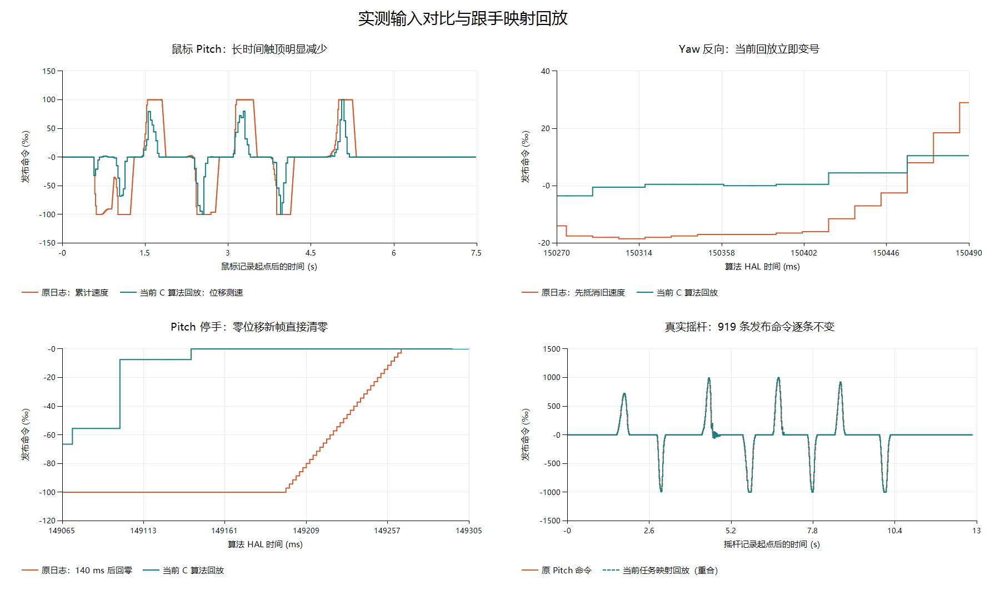

# 鼠标与摇杆实测输入对比

## 结论与范围

本轮输入链没有持续丢帧或日志跳号的证据。手感问题可在实际 C 鼠标算法中复现：位移累计成速度使等速移动不断增速，反向先抵消旧速度，零位移帧不停止，最后非零输入后 140 ms 才回零。用户选择跟手模式，现已替换为按接收帧间隔测速。

日志记录输入和发布命令，不含真实姿态、目标、编码器、电流或人工限位结果。这里验证输入映射和命令时序，不能据此验收机械跟随、触底抖动或自稳精度。

## 原始资料与完整性

原文件只读，路径为 `C:/Users/zhoujinyuan/Desktop/鼠标.txt` 和 `摇杆.txt`。

| 指标 | 鼠标 | 摇杆 |
| --- | --- | --- |
| 文件字节 | 107870 | 112773 |
| 完整 R / C / S 行 | 534 / 981 / 8 | 919 / 919 / 13 |
| 命令 HAL ms 区间 | 147965～155441，7.476 s | 89919～102771，12.852 s |
| R 帧序号区间 | 10569～11102 | 6422～7340 |
| R/C 记录号区间 | 23520～25034 | 15190～17027 |
| 区间内记录号/接收帧号缺口 | 均无 | 均无 |
| R 帧间隔 min / median / max | 13977 / 13998 / 14028 μs | 13978 / 13998 / 14027 μs |
| 新帧交给算法的接收年龄 | 535 次均 2 ms，含首 C 引用的边界帧 | 918 次 1 ms、1 次 2 ms |
| S 行日志丢样 / 接收溢出 / 非法帧 | 均 0 | 均 0 |
| UART 错误 | 累计 1，区间内未增长 | 累计 1，区间内未增长 |
| 最大诊断队列深度 | 3 / 128 | 3 / 128 |

鼠标第一行是截断的 R 行尾，首个完整 C 引用 10568 帧，这是文件起始边界缺损，未计为运行中丢帧；其余非空行均符合模式。两份文件每个 C 的实际累计帧数均为 0 或 1。鼠标 R/C 的 X、Y 位移代数和分别一致，为 +20、-190 count。帧间隔约 14 ms，不是任务周期 2 ms；DWT 短差按 uint32_t 回绕处理，长时间窗口用 HAL ms。

SHA256：

```text
鼠标.txt 8340f8d0d4949265769a2775c483cf5955efb05d606431c09f83e2810375286e
摇杆.txt 8e00b0c6d30ea03f13f539d60ef3fae3e95b78184fc883fa18bd5f35340f8eb1
```

## 差异与假设验证

按采集完整性、饱和、反向抵消、停手拖尾的顺序检查：

| 可证伪预测 | 实测 / 实际算法回放 |
| --- | --- |
| 若接收或日志丢样主导，应出现序号缺口或丢样计数增长 | 完整区段无缺口，S 中对应计数无增长；不支持区间内持续丢样 |
| 若速度累计触顶，应有位移仍变化、输出长时间恒为上限 | Pitch 非零输出 3124 ms，其中 1652 ms 为 ±100‰，占 52.9% |
| 若反向先抵消旧速度，应出现已映射输入方向与当前输出相反 | Yaw 120 次非零输入中 33 次、Pitch 154 次中 12 次出现该情况 |
| 若保持/回中主导拖尾，应在最后非零接收时间后固定回零 | 两轴各 6 个完整停止段均在 140 ms 回零，符合 70 ms 保持 + 70 ms 回中 |

鼠标 CH0～CH3 均为零。X 范围 -24～+31 count，发布 Yaw 范围 -71～+54‰；Y 范围 -348～+231 count，发布 Pitch 为 -100～+100‰。摇杆文件鼠标始终零，CH1 覆盖 -660～+660、Pitch 命令 -1000～+1000‰；CH0 仅为 0～33、Yaw 命令最高 50‰。本次真实摇杆数据主要验证 Pitch，不能当作 Yaw 满行程对照。

具体反向窗口：算法时间 150317 ms，Yaw X=-1 count，本次新增方向为正，但输出从 -18.5 只变为 -18.0‰。后续仍有反向输入，到 150457 ms 才变为 +8‰，中间相隔 140 ms。这是该窗口的观察值，不是所有反向动作的固定延迟；抵消旧速度时每个小增量还会重新延长保持。

具体停手窗口：Pitch 最后非零帧 149125 ms，149127 ms 输出为 -100‰，直到 149265 ms 清零。若人工输入获准、按现有 40 rpm 满量程积分，从该 C 行到清零仅尾段可新增约 -2.496°目标角，不是实测机械位移。零速度之后，正式自稳仍保持最后目标。

## 实际代码反馈环

临时程序位于系统 Temp，不加入工程。先将 C 行原整数输入交给修改前实际 `MouseVirtualJoystick_Update()`，1900 条记录在 0.001‰ 量化精度上全部一致；最大未量化误差 0.000496094‰。实际任务配置、算法及任务适配函数构成四项行为检查：

```text
replay.cmd
REPLAY mouse: 981 rows, 0 mismatches at 0.001 permille
REPLAY stick: 919 rows, 0 mismatches at 0.001 permille
FAIL speed: equal delta/interval changed -10.000 -> -20.000
FAIL reversal: reverse delta still outputs -19.500
FAIL stop: zero delta still outputs -19.500
FAIL normalization: equal count/time outputs -39.500 vs -10.000
FOLLOW_HAND: 4 behavior failures
```

归一化检查顺序为 14 ms/20 count、反向、零帧、28 ms/40 count；最后检查与首次 -10‰ 一致。该回放隔离输入映射，不模拟电机动力学。

## 当前实现与对照

新公式为 `clamp(delta × signed_gain × reference_ms / dt_ms, ±100‰)`。保留两轴增益 0.5 和方向 -1/+1，参考周期 14 ms；新速度覆盖旧速度，零位移新帧直接清本轴。无新帧时保持 14 ms、线性回中 14 ms，在首个达到 28 ms 的任务调用中归零。任务延迟消费多帧时用累计位移和对应接收间隔计算平均速度。

同一鼠标日志由新实际 C 算法回放，按记录时间保持输出统计：

| 指标 | 原累计映射 | 当前测速映射 |
| --- | --- | --- |
| Yaw 输出范围 | -71～+54‰ | -15.5～+12‰ |
| Pitch 输出范围 | -100～+100‰ | -100～+100‰ |
| Pitch 在 ±100‰ 的时间 | 1652 ms | 98 ms |
| 非零新输入与输出方向相反 | Yaw 33、Pitch 12 次 | 两轴均 0 次 |
| 新零位移帧 | 保持/回中旧速度 | 本周期清零本轴 |
| 919 条摇杆发布命令 | 原始记录 | 每条量化结果不变 |

幅度变化是取消累计的直接结果。当前 Yaw 原始输入较小，新峰值 15.5‰ 在 40 rpm 满量程下对应约 3.72°/s 目标速度。是否增加某轴灵敏度要靠新模式手感确认，不能从两份不同动作轨迹推断最佳值。最高鼠标速度仍为 24°/s。



图中“当前回放”为当前真实算法输出，不是修改后实机采集；原始记录时间各自归零，不是同时采集。

当前临时 `follow_hand.cmd` 输出：

```text
PASS: constant speed, immediate reversal/zero, interval normalization, duplicate/batch, stale/wrap, invalid/fractional inputs
PASS: real DBUS decode/runtime/command path, batch normalization, unchanged stick, timeout/reconnect timestamps
PASS: mouse replay 981 rows; 0 opposite-direction input responses
PASS: stick replay 919 rows; every published stick command unchanged
PASS: updated capture header and 5-second simulated 921600 baud stream; max packet 392 bytes, no new drops
PASS: 22664 checks total
```

三个主机指针截断警告来自 32 位 MCU DMA 地址在 64 位替身中的转换。关闭采集、关闭全局日志及启用 MotionCal 的三个主机语法配置通过。技术附录重建为 541 个宏位置、58 个关键函数；差异检查除既有 `.ioc` 五处硬件标签尾空格外通过，未更改这些标签。新增配置字段、调用点和日志头已同步；无 CubeMX 区域、硬件初始化或闭环参数改动，未构建/生成 ARM 固件。

## 上板验收

用户在 VS Code 构建并烧录当前源码，串口保持 921600/8N1。先在中位分别试 Yaw/Pitch 慢移、快移、反向和停手，保存带启动说明的原日志。R/C 应满足等速不持续增速、非零新输入同方向输出、零位移新帧本轴为零；S 中丢样、接收溢出及错误计数不增长。

若输入命令满足这些条件但实际运动仍滞后或振荡，再将同次目标/实际姿态、编码器、电流和输入时间对齐，独立检查机电控制。Pitch 人工下界余量、真实制动和 Yaw 长期漂移继续待实测。软件限位仍只过滤人工目标增量/前馈，自稳纠偏继续输出。
